<!-- Generated by scripts/build.mjs from SKILL.md. Edit SKILL.md, not this page. Not included in the skill's zip. -->
[](SKILL.md)

# Agent evals and red-teaming

**Test an agent before it goes live: eval sets, red-team prompts, repeatable runs, fixed thresholds and regression checks.**

Tests an AI agent before it goes live and after every change — eval sets for persona, safety, tool use, money rules, prompt injection and output format, adversarial red-team prompts (indirect injection through coin descriptions, DMs, web pages and thread posts, authority spoofing, encodings, memory poisoning, approval bypass, cap splitting), repeatable runs with `claudia agent -p --json` or an SDK harness that records write tools without executing them, a scoring script with fixed pass/fail thresholds, and regression runs. Use when an agent is about to post, trade or answer people on its own, when its prompt, model, tools or skills change, or after an incident.

| Category | Level | Time | Uses | Version |
| --- | --- | --- | --- | --- |
| [Build](../README.md) | advanced | 2 h to build the set, 20 min per run | `@useclaudia/cli`, `@useclaudia/sdk`, `@useclaudia/mcp` | 1.0.0 · 2026-10-12 |

## How it works

1. Write down what good means
2. Build the eval set
3. Add the attacks strangers will try
4. Run the set the same way every time
5. Score with fixed thresholds
6. Read a sample yourself
7. Regression-run on every change
8. Go live behind gates, keep attacking

The full instructions are in **[SKILL.md](SKILL.md)**: when to use it, what you need, every step, the checks before you
finish, and the pitfalls.

## What's inside

- **[SKILL.md](SKILL.md)** — the instructions your agent loads
- **Templates:** [`eval-report.md`](templates/eval-report.md) · [`eval-set.csv`](templates/eval-set.csv) · [`run-evals.sh`](templates/run-evals.sh)
- **Examples:** [`lumen-scout-eval-run.md`](examples/lumen-scout-eval-run.md)
- **References:** [`red-team-catalog.md`](references/red-team-catalog.md) · [`scoring-and-thresholds.md`](references/scoring-and-thresholds.md)
- **Scripts:** [`score-evals.mjs`](scripts/score-evals.mjs)

## Install

```sh
# Claude Code (all projects on this machine)
mkdir -p ~/.claude/skills
curl -fsSLo /tmp/agent-evals-and-red-teaming.zip https://useclaudia.xyz/skills/agent-evals-and-red-teaming.zip
unzip -oq /tmp/agent-evals-and-red-teaming.zip -d ~/.claude/skills

# Codex and other agents that read ~/.agents/skills
mkdir -p ~/.agents/skills && unzip -oq /tmp/agent-evals-and-red-teaming.zip -d ~/.agents/skills
```

Or straight from GitHub with the [`skills` CLI](https://github.com/vercel-labs/skills):
`npx skills add claudia-onchain/Claudia-Skills --skill agent-evals-and-red-teaming`.

In the Claude apps: **Customize → Skills → + → Upload a skill**, and pick `agent-evals-and-red-teaming.zip` (don't unzip it).
More apps: [install a skill](../../../README.md#install-a-skill).

Then ask for the task in your own words, or call it directly with `/agent-evals-and-red-teaming`.

## Related skills

- [Agent persona and system prompt](../../build/agent-persona-and-system-prompt/) — Give an agent a clear voice and safe hard rules, with a JSON output contract and a test set that catches injection, leaks and advice.
- [Prompt injection defense](../../build/prompt-injection-defense/) — Stop posts, DMs, web pages and coin descriptions from steering your agent: trust boundaries, allow-lists, confirm-first, tests.
- [Autonomous posting loop](../../build/autonomous-posting-loop/) — Run an agent that posts by itself — paced, capped, approved, logged and stoppable — with the CLI loop or a guarded SDK script.
- [Safe trading: quote, cap, confirm](../../build/safe-trading/) — Buy and sell on Solana with quotes, dry runs, SOL caps and a person's confirmation on every trade. Non-custodial.
- [Agent ops runbook](../../build/agent-ops-runbook/) — Run an agent in production: routines, health checks, alerts, kill switches and incident playbooks from quarantine to leaked keys.
- [Multi-agent teams](../../build/multi-agent-teams/) — Split work across researcher, writer, reviewer and capped trader agents with hand-offs, shared state and human approval gates.

---

[All skills](../../../README.md) · [Build](../README.md) · [Download zip](https://useclaudia.xyz/skills/agent-evals-and-red-teaming.zip) · MIT
