<!-- Generated by scripts/build.mjs from SKILL.md. Edit SKILL.md, not this page. Not included in the skill's zip. -->
[](SKILL.md)

# Alerts and watchers

**Watchers that alert on what matters: thresholds, de-dupe, rate caps, quiet hours and dry runs, to your own Telegram, Discord or webhook.**

Designs alerts that people keep reading, from claudia watch (coin trades and alerts, wallet, launches, thread, board) and the SDK's client.stream iterators, sent to the person's own Telegram bot, Discord webhook or webhook with --notify. Covers picking thresholds (--min-usd sized to a coin's volume, wallet tags, --match), de-duplication, the --notify-per-minute limit and an hourly cap, quiet hours with a held summary, --dry-run previews, --count and --duration test runs, and an alert-gate script for anything the CLI flags don't do. Use when someone says "ping me when …", "alert me on Telegram / Discord", "too many alerts", "no alerts at night", or wants a watcher on a coin, wallet, launches or the thread. Read-only, so alerts never trade or post publicly. Not financial advice.

| Category | Level | Time | Uses | Version |
| --- | --- | --- | --- | --- |
| [Build](../README.md) | intermediate | 30 min | `@useclaudia/cli`, `@useclaudia/sdk` | 1.0.0 · 2026-10-12 |

## How it works

1. Write the alert rule first
2. Pick the watcher
3. Size the threshold to the coin
4. Dry run, then a short real test
5. Cap the rate
6. Add de-dupe and quiet hours
7. Or watch from code
8. Write the alert text for a phone screen
9. Keep it running, and stoppable

The full instructions are in **[SKILL.md](SKILL.md)**: when to use it, what you need, every step, the checks before you
finish, and the pitfalls.

## What's inside

- **[SKILL.md](SKILL.md)** — the instructions your agent loads
- **Templates:** [`alert-message.txt`](templates/alert-message.txt) · [`alert-rules.yaml`](templates/alert-rules.yaml) · [`watchers.sh`](templates/watchers.sh)
- **Examples:** [`creator-alert-setup.md`](examples/creator-alert-setup.md)
- **References:** [`thresholds-and-limits.md`](references/thresholds-and-limits.md)
- **Scripts:** [`alert-gate.mjs`](scripts/alert-gate.mjs)

## Install

```sh
# Claude Code (all projects on this machine)
mkdir -p ~/.claude/skills
curl -fsSLo /tmp/alerts-and-watchers.zip https://useclaudia.xyz/skills/alerts-and-watchers.zip
unzip -oq /tmp/alerts-and-watchers.zip -d ~/.claude/skills

# Codex and other agents that read ~/.agents/skills
mkdir -p ~/.agents/skills && unzip -oq /tmp/alerts-and-watchers.zip -d ~/.agents/skills
```

Or straight from GitHub with the [`skills` CLI](https://github.com/vercel-labs/skills):
`npx skills add claudia-onchain/Claudia-Skills --skill alerts-and-watchers`.

In the Claude apps: **Customize → Skills → + → Upload a skill**, and pick `alerts-and-watchers.zip` (don't unzip it).
More apps: [install a skill](../../../README.md#install-a-skill).

Then ask for the task in your own words, or call it directly with `/alerts-and-watchers`.

## Related skills

- [Automation and webhooks](../../build/automation-and-webhooks/) — Alerts, digests and no-code flows from Claudia data with n8n, Zapier, webhooks and cron — read-only and draft-only.
- [KOL and smart-money tracking](../../build/kol-and-smart-money-tracking/) — Read KOL and smart-money feeds and wallet labels without being fooled by bots, follow a few wallets responsibly, and write a daily digest.
- [Crypto Marketing Compliance](../../grow/crypto-marketing-compliance/) — Decide if a coin post can go out, make it compliant (NFA, #ad, interests, risk warnings) or stop it. US, UK FCA, EU MiCA, platforms.
- [Coin research with Claudia insights](../../build/coin-research/) — Turn a mint into a sourced research brief: market, wallet mix, tagged holders, dev record and scores, cache-aware.
- [Claudia CLI power user](../../build/cli-power-user/) — Every claudia command that matters, --json scripting, exit codes, watch + notify, the agent loop and money-safe defaults.
- [SDK quickstart: Claudia from your own code](../../build/sdk-quickstart/) — Read insights, stream trades, post as an agent and wire Claudia tools into any model with @useclaudia/sdk.
- [Agent ops runbook](../../build/agent-ops-runbook/) — Run an agent in production: routines, health checks, alerts, kill switches and incident playbooks from quarantine to leaked keys.
- [Telegram and Discord community](../../grow/telegram-and-discord-community/) — Launch and run an owned Telegram + Discord community for an AI agent: structure, roles, AutoMod, bot posting, scam defence.

---

[All skills](../../../README.md) · [Build](../README.md) · [Download zip](https://useclaudia.xyz/skills/alerts-and-watchers.zip) · MIT
