<!-- Generated by scripts/build.mjs from SKILL.md. Edit SKILL.md, not this page. Not included in the skill's zip. -->
[](SKILL.md)

# Automation and webhooks

**Alerts, digests and no-code flows from Claudia data with n8n, Zapier, webhooks and cron — read-only and draft-only.**

Automates Claudia safely with webhooks, n8n, Zapier, cron, systemd and launchd — trade, launch, wallet and thread alerts from claudia watch --notify, a deduplicating poller for signal / KOL / smart-money feeds, n8n workflows (Webhook → token check → filter → Telegram or Discord; Schedule → AI agent with the read-only Claudia MCP Client Tool → private review chat), Zapier Catch Hook and MCP Client recipes, and service units that keep watchers running. Keeps every automation read-only or draft-only, never money-moving. Use when someone wants alerts, digests, bots, no-code flows or scheduled jobs around Claudia data, or asks how to receive Claudia webhooks.

| Category | Level | Time | Uses | Version |
| --- | --- | --- | --- | --- |
| [Build](../README.md) | intermediate | 40 min | `@useclaudia/cli`, `@useclaudia/sdk`, `@useclaudia/mcp` | 1.0.0 · 2026-10-08 |

## How it works

1. Choose the pattern
2. Make a receiving URL with a secret
3. Send events
4. Build the n8n flow
5. Respect rate limits and dedupe
6. Keep watchers alive and stoppable
7. Label and disclaim

The full instructions are in **[SKILL.md](SKILL.md)**: when to use it, what you need, every step, the checks before you
finish, and the pitfalls.

## What's inside

- **[SKILL.md](SKILL.md)** — the instructions your agent loads
- **Templates:** [`n8n-http-signals.json`](templates/n8n-http-signals.json) · [`n8n-mcp-research-digest.json`](templates/n8n-mcp-research-digest.json) · [`n8n-webhook-alerts.json`](templates/n8n-webhook-alerts.json) · [`service-units.md`](templates/service-units.md) · [`zapier-recipe.md`](templates/zapier-recipe.md)
- **Examples:** [`whale-alerts-end-to-end.md`](examples/whale-alerts-end-to-end.md)
- **References:** [`n8n-guide.md`](references/n8n-guide.md) · [`payloads.md`](references/payloads.md)
- **Scripts:** [`poll-signals.mjs`](scripts/poll-signals.mjs)

## Install

```sh
# Claude Code (all projects on this machine)
mkdir -p ~/.claude/skills
curl -fsSLo /tmp/automation-and-webhooks.zip https://useclaudia.xyz/skills/automation-and-webhooks.zip
unzip -oq /tmp/automation-and-webhooks.zip -d ~/.claude/skills

# Codex and other agents that read ~/.agents/skills
mkdir -p ~/.agents/skills && unzip -oq /tmp/automation-and-webhooks.zip -d ~/.agents/skills
```

Or straight from GitHub with the [`skills` CLI](https://github.com/vercel-labs/skills):
`npx skills add claudia-onchain/Claudia-Skills --skill automation-and-webhooks`.

In the Claude apps: **Customize → Skills → + → Upload a skill**, and pick `automation-and-webhooks.zip` (don't unzip it).
More apps: [install a skill](../../../README.md#install-a-skill).

Then ask for the task in your own words, or call it directly with `/automation-and-webhooks`.

## Related skills

- [Autonomous posting loop](../../build/autonomous-posting-loop/) — Run an agent that posts by itself — paced, capped, approved, logged and stoppable — with the CLI loop or a guarded SDK script.
- [Social publishing with approval](../../build/social-publishing/) — Draft, preview, approve and publish once to X, Telegram, Bluesky and more with your own apps, labels and a kill switch.
- [Safe trading: quote, cap, confirm](../../build/safe-trading/) — Buy and sell on Solana with quotes, dry runs, SOL caps and a person's confirmation on every trade. Non-custodial.
- [Agent ops runbook](../../build/agent-ops-runbook/) — Run an agent in production: routines, health checks, alerts, kill switches and incident playbooks from quarantine to leaked keys.
- [Crypto Marketing Compliance](../../grow/crypto-marketing-compliance/) — Decide if a coin post can go out, make it compliant (NFA, #ad, interests, risk warnings) or stop it. US, UK FCA, EU MiCA, platforms.
- [Claudia CLI power user](../../build/cli-power-user/) — Every claudia command that matters, --json scripting, exit codes, watch + notify, the agent loop and money-safe defaults.
- [SDK quickstart: Claudia from your own code](../../build/sdk-quickstart/) — Read insights, stream trades, post as an agent and wire Claudia tools into any model with @useclaudia/sdk.
- [Set up Claudia's MCP servers in any AI app](../../build/mcp-setup/) — Add Claudia Data, Trade or the local server to Claude, ChatGPT, Cursor, Codex and 15 more apps, with the safest scopes.
- [Coin research with Claudia insights](../../build/coin-research/) — Turn a mint into a sourced research brief: market, wallet mix, tagged holders, dev record and scores, cache-aware.
- [Rug check: a red / amber / green scorecard](../../build/rug-check/) — A repeatable rug check for Solana coins: 20 checks, thresholds, reasons, and an honest verdict that never says safe.
- [Telegram and Discord community](../../grow/telegram-and-discord-community/) — Launch and run an owned Telegram + Discord community for an AI agent: structure, roles, AutoMod, bot posting, scam defence.

---

[All skills](../../../README.md) · [Build](../README.md) · [Download zip](https://useclaudia.xyz/skills/automation-and-webhooks.zip) · MIT
