<!-- Generated by scripts/build.mjs from SKILL.md. Edit SKILL.md, not this page. Not included in the skill's zip. -->
[](SKILL.md)

# Run and extend Claudia Local

**Set up Claudia Local's encrypted vault, studio, approvals and caps, expose its MCP, and extend it with your own providers and tools.**

Installs, configures, operates and extends Claudia Local, the desktop agent and creator studio that runs on 127.0.0.1:3939 with the person's own keys in an encrypted vault — chat with any OpenAI-compatible model, helper agents, memory, a sandboxed workspace, Generate (images, video, voice, music, avatars with cost estimates, approvals and caps), Socials (connections, composer previews, approvals queue, calendar, inbox, campaigns, kill switch), the Claudia tab (thread, paper trading, quotes, trades and launches the person confirms), and a local MCP server on 127.0.0.1:3940. Use when someone wants to run Claudia on their own computer, connect keys and socials, approve or schedule posts, set spending caps, expose the studio to Claude Code or Cursor over MCP, or add a provider, network, tool or campaign template to the code.

| Category | Level | Time | Uses | Version |
| --- | --- | --- | --- | --- |
| [Build](../README.md) | intermediate | 45 min | `@useclaudia/sdk`, `@useclaudia/media`, `@useclaudia/social` | 1.0.0 · 2026-10-08 |

## How it works

1. Connections
2. Composer
3. Approvals
4. Calendar
5. Inbox
6. Campaigns
7. Stop all posting

The full instructions are in **[SKILL.md](SKILL.md)**: when to use it, what you need, every step, the checks before you
finish, and the pitfalls.

## What's inside

- **[SKILL.md](SKILL.md)** — the instructions your agent loads
- **Templates:** [`identity-addendum.md`](templates/identity-addendum.md) · [`local-mcp-configs.md`](templates/local-mcp-configs.md) · [`operator-checklist.md`](templates/operator-checklist.md)
- **Examples:** [`first-week.md`](examples/first-week.md)
- **References:** [`extending.md`](references/extending.md) · [`security-model.md`](references/security-model.md) · [`socials-setup.md`](references/socials-setup.md)

## Install

```sh
# Claude Code (all projects on this machine)
mkdir -p ~/.claude/skills
curl -fsSLo /tmp/claudia-local-studio.zip https://useclaudia.xyz/skills/claudia-local-studio.zip
unzip -oq /tmp/claudia-local-studio.zip -d ~/.claude/skills

# Codex and other agents that read ~/.agents/skills
mkdir -p ~/.agents/skills && unzip -oq /tmp/claudia-local-studio.zip -d ~/.agents/skills
```

Or straight from GitHub with the [`skills` CLI](https://github.com/vercel-labs/skills):
`npx skills add claudia-onchain/Claudia-Skills --skill claudia-local-studio`.

In the Claude apps: **Customize → Skills → + → Upload a skill**, and pick `claudia-local-studio.zip` (don't unzip it).
More apps: [install a skill](../../../README.md#install-a-skill).

Then ask for the task in your own words, or call it directly with `/claudia-local-studio`.

## Related skills

- [Claudia platform overview](../../build/claudia-platform-overview/) — A map of Claudia: the board, launches, the agent thread, agent modes, packages, MCP and Claudia Local — and which to use when.
- [Media pipelines with your own keys](../../build/media-pipelines/) — Price a shot list, generate images, video, voice and avatars inside caps and approvals, keep provenance, hand off to posting.
- [Social publishing with approval](../../build/social-publishing/) — Draft, preview, approve and publish once to X, Telegram, Bluesky and more with your own apps, labels and a kill switch.
- [Create an agent on Claudia](../../build/create-an-agent/) — Register an external (or hosted) agent: device key, agent wallet, ck_live key, first post, passport — safely, in about 15 minutes.
- [Image prompting fundamentals](../../create/image-prompting-fundamentals/) — The prompt structure, vocabulary and per-model dialects that turn an idea into the image you meant, on any 2026 model.
- [Video prompting](../../create/video-prompting/) — Prompt AI video that keeps her face: first frames, camera language, timing beats, audio, stitching and fixes per model.
- [Set up Claudia's MCP servers in any AI app](../../build/mcp-setup/) — Add Claudia Data, Trade or the local server to Claude, ChatGPT, Cursor, Codex and 15 more apps, with the safest scopes.
- [Agent persona and system prompt](../../build/agent-persona-and-system-prompt/) — Give an agent a clear voice and safe hard rules, with a JSON output contract and a test set that catches injection, leaks and advice.
- [Wallet and key security](../../build/wallet-and-key-security/) — Inventory, protect, rotate and revoke every key in a Claudia agent setup, and respond fast if one leaks.
- [Safe trading: quote, cap, confirm](../../build/safe-trading/) — Buy and sell on Solana with quotes, dry runs, SOL caps and a person's confirmation on every trade. Non-custodial.
- [Launch a coin on pump.fun through Claudia](../../build/launch-a-coin/) — Launch a pump.fun coin with the 70/30 creator fee split locked in one transaction: plan, dry run, sign, announce honestly.
- [Agent ops runbook](../../build/agent-ops-runbook/) — Run an agent in production: routines, health checks, alerts, kill switches and incident playbooks from quarantine to leaked keys.
- [Claudia character bible](../../create/claudia-character-bible/) — Who Claudia is, exactly: her look, wardrobe, worlds, palette, voice, captions and hard limits — plus a template for your own character.
- [Launch Campaigns](../../grow/launch-campaigns/) — Run a T-14 to T+7 launch for an agent, series, product or Solana coin: brief, gates, scheduled drafts, monitoring, report.

---

[All skills](../../../README.md) · [Build](../README.md) · [Download zip](https://useclaudia.xyz/skills/claudia-local-studio.zip) · MIT
