<!-- Generated by scripts/build.mjs from SKILL.md. Edit SKILL.md, not this page. Not included in the skill's zip. -->
[](SKILL.md)

# Creator fees and harvest

**Read what your launches earned, harvest only when it is worth the fee, and keep a clean 70/30 fee ledger on Solana and Robinhood Chain.**

Checks and collects the creator fees a Claudia launch earns, split 70% creator / 30% platform on Solana (pump.fun fee sharing) and Robinhood Chain (beta, one FeeSplitter per launch). Covers claudia fees and claudia harvest, the SDK's launchesBy, launchFees, harvestPlan, evm.fees, evm.harvest and readFeeSplitter, the get_launch_fees MCP tool, the collector and keeper bots that pay out without anyone claiming, when a manual harvest is worth its network fee or gas, and a fee ledger. Use when someone asks "how much have my coins earned", "how do I claim creator fees", "what is the FeeSplitter", wants to harvest now, or needs fee records for their books. Every harvest is dry-run first and sent only after a person says yes. Not financial or tax advice.

| Category | Level | Time | Uses | Version |
| --- | --- | --- | --- | --- |
| [Build](../README.md) | intermediate | 20 min | `@useclaudia/cli`, `@useclaudia/sdk`, `@useclaudia/mcp` | 1.0.0 · 2026-10-12 |

## How it works

1. Find the launch ids
2. Read what one launch has earned
3. Decide whether to harvest at all
4. Dry run the harvest
5. Ask, then send
6. Verify it landed
7. Record it
8. Automate the reading, not the sending

The full instructions are in **[SKILL.md](SKILL.md)**: when to use it, what you need, every step, the checks before you
finish, and the pitfalls.

## What's inside

- **[SKILL.md](SKILL.md)** — the instructions your agent loads
- **Templates:** [`fee-ledger.csv`](templates/fee-ledger.csv) · [`harvest-confirmation.md`](templates/harvest-confirmation.md) · [`harvest-decision.md`](templates/harvest-decision.md)
- **Examples:** [`two-chain-fee-check.md`](examples/two-chain-fee-check.md)
- **References:** [`fee-mechanics-by-chain.md`](references/fee-mechanics-by-chain.md)
- **Scripts:** [`fees-snapshot.mjs`](scripts/fees-snapshot.mjs)

## Install

```sh
# Claude Code (all projects on this machine)
mkdir -p ~/.claude/skills
curl -fsSLo /tmp/creator-fees-and-harvest.zip https://useclaudia.xyz/skills/creator-fees-and-harvest.zip
unzip -oq /tmp/creator-fees-and-harvest.zip -d ~/.claude/skills

# Codex and other agents that read ~/.agents/skills
mkdir -p ~/.agents/skills && unzip -oq /tmp/creator-fees-and-harvest.zip -d ~/.agents/skills
```

Or straight from GitHub with the [`skills` CLI](https://github.com/vercel-labs/skills):
`npx skills add claudia-onchain/Claudia-Skills --skill creator-fees-and-harvest`.

In the Claude apps: **Customize → Skills → + → Upload a skill**, and pick `creator-fees-and-harvest.zip` (don't unzip it).
More apps: [install a skill](../../../README.md#install-a-skill).

Then ask for the task in your own words, or call it directly with `/creator-fees-and-harvest`.

## Related skills

- [Launch a coin on pump.fun through Claudia](../../build/launch-a-coin/) — Launch a pump.fun coin with the 70/30 creator fee split locked in one transaction: plan, dry run, sign, announce honestly.
- [Safe trading: quote, cap, confirm](../../build/safe-trading/) — Buy and sell on Solana with quotes, dry runs, SOL caps and a person's confirmation on every trade. Non-custodial.
- [Alerts and watchers](../../build/alerts-and-watchers/) — Watchers that alert on what matters: thresholds, de-dupe, rate caps, quiet hours and dry runs, to your own Telegram, Discord or webhook.
- [Automation and webhooks](../../build/automation-and-webhooks/) — Alerts, digests and no-code flows from Claudia data with n8n, Zapier, webhooks and cron — read-only and draft-only.
- [Portfolio and P&L tracking](../../build/portfolio-and-pnl-tracking/) — Know what an agent wallet holds and whether it is up or down, across SOL and ETH, with every fee and gas cost in one ledger.
- [Wallet and key security](../../build/wallet-and-key-security/) — Inventory, protect, rotate and revoke every key in a Claudia agent setup, and respond fast if one leaks.
- [Claudia CLI power user](../../build/cli-power-user/) — Every claudia command that matters, --json scripting, exit codes, watch + notify, the agent loop and money-safe defaults.
- [Monetization Streams](../../grow/monetization-streams/) — Map 2026 income streams for an AI creator, check eligibility, plan a revenue mix, disclose and keep records.

---

[All skills](../../../README.md) · [Build](../README.md) · [Download zip](https://useclaudia.xyz/skills/creator-fees-and-harvest.zip) · MIT
