<!-- Generated by scripts/build.mjs from SKILL.md. Edit SKILL.md, not this page. Not included in the skill's zip. -->
[](SKILL.md)

# Local models with Ollama and LM Studio

**Run the agent's chat model on your own machine: size it to your hardware, connect Claudia Local, and know what still leaves the device.**

Runs an agent's chat model on the person's own computer with Ollama or LM Studio and connects it to Claudia Local — install, picking a model size that fits the RAM or VRAM, raising the context window, how Claudia Local detects local servers on 127.0.0.1:11434 and 127.0.0.1:1234, tool-calling and vision caveats, Docker and custom ports, and the real privacy trade-offs (cloud tags, fallbacks, network exposure). Use when someone wants a private or offline agent, wants to stop paying per token for chat, sees "Ollama not found" or "This model can't use tools", or needs to choose between a local and a hosted model for each role.

| Category | Level | Time | Uses | Version |
| --- | --- | --- | --- | --- |
| [Build](../README.md) | intermediate | 30–60 min | `claudia-local`, `ollama`, `lm-studio` | 1.0.0 · 2026-10-12 |

## How it works

1. Install one model server
2. Pick a model that fits the machine
3. Pull it and check it runs
4. Raise the context window
5. Connect Claudia Local
6. Test tool calling before you rely on it
7. Assign roles on purpose
8. Check what still leaves the machine
9. Write it down and keep it current

The full instructions are in **[SKILL.md](SKILL.md)**: when to use it, what you need, every step, the checks before you
finish, and the pitfalls.

## What's inside

- **[SKILL.md](SKILL.md)** — the instructions your agent loads
- **Templates:** [`Modelfile`](templates/Modelfile) · [`local-model-setup.md`](templates/local-model-setup.md) · [`tool-call-smoke-test.md`](templates/tool-call-smoke-test.md)
- **Examples:** [`16gb-laptop-private-agent.md`](examples/16gb-laptop-private-agent.md)
- **References:** [`hardware-and-sizing.md`](references/hardware-and-sizing.md) · [`how-claudia-local-finds-models.md`](references/how-claudia-local-finds-models.md) · [`privacy-trade-offs.md`](references/privacy-trade-offs.md)

## Install

```sh
# Claude Code (all projects on this machine)
mkdir -p ~/.claude/skills
curl -fsSLo /tmp/local-models-with-ollama.zip https://useclaudia.xyz/skills/local-models-with-ollama.zip
unzip -oq /tmp/local-models-with-ollama.zip -d ~/.claude/skills

# Codex and other agents that read ~/.agents/skills
mkdir -p ~/.agents/skills && unzip -oq /tmp/local-models-with-ollama.zip -d ~/.agents/skills
```

Or straight from GitHub with the [`skills` CLI](https://github.com/vercel-labs/skills):
`npx skills add claudia-onchain/Claudia-Skills --skill local-models-with-ollama`.

In the Claude apps: **Customize → Skills → + → Upload a skill**, and pick `local-models-with-ollama.zip` (don't unzip it).
More apps: [install a skill](../../../README.md#install-a-skill).

Then ask for the task in your own words, or call it directly with `/local-models-with-ollama`.

## Related skills

- [Run and extend Claudia Local](../../build/claudia-local-studio/) — Set up Claudia Local's encrypted vault, studio, approvals and caps, expose its MCP, and extend it with your own providers and tools.
- [Agent ops runbook](../../build/agent-ops-runbook/) — Run an agent in production: routines, health checks, alerts, kill switches and incident playbooks from quarantine to leaked keys.
- [Wallet and key security](../../build/wallet-and-key-security/) — Inventory, protect, rotate and revoke every key in a Claudia agent setup, and respond fast if one leaks.
- [Agent persona and system prompt](../../build/agent-persona-and-system-prompt/) — Give an agent a clear voice and safe hard rules, with a JSON output contract and a test set that catches injection, leaks and advice.
- [Prompt injection defense](../../build/prompt-injection-defense/) — Stop posts, DMs, web pages and coin descriptions from steering your agent: trust boundaries, allow-lists, confirm-first, tests.
- [Agent evals and red-teaming](../../build/agent-evals-and-red-teaming/) — Test an agent before it goes live: eval sets, red-team prompts, repeatable runs, fixed thresholds and regression checks.

---

[All skills](../../../README.md) · [Build](../README.md) · [Download zip](https://useclaudia.xyz/skills/local-models-with-ollama.zip) · MIT
