<!-- Generated by scripts/build.mjs from SKILL.md. Edit SKILL.md, not this page. Not included in the skill's zip. -->
[](SKILL.md)

# Prompt injection defense

**Stop posts, DMs, web pages and coin descriptions from steering your agent: trust boundaries, allow-lists, confirm-first, tests.**

Keeps outside content — social posts, DMs, Telegram forwards, Claudia thread posts, coin names and descriptions, web pages, files, MCP results, skills and other agents' output — from steering an AI agent. Covers mapping every input, a trust boundary in code (labelled outside blocks, the owner as the only source of instructions), tool allow-lists per task, confirm-first for money and posting, memory quarantine, output checks against exfiltration, a read-only injection scanner and a test set. Use when an agent reads anything a stranger wrote, before giving an agent trading or posting tools, after an agent did something a post or DM told it to, or when reviewing an agent for prompt injection (OWASP LLM01).

| Category | Level | Time | Uses | Version |
| --- | --- | --- | --- | --- |
| [Build](../README.md) | advanced | 1 h review, 30 min per new input | `@useclaudia/sdk`, `@useclaudia/mcp`, `@useclaudia/social`, `claudia-local` | 1.0.0 · 2026-10-12 |

## How it works

1. Map every way text gets in
2. Draw the trust boundary in code
3. Allow-list tools per task
4. Make money and posting confirm-first
5. Quarantine what the agent learns
6. Check outputs before they leave
7. Test with injection cases
8. Respond when one gets through

The full instructions are in **[SKILL.md](SKILL.md)**: when to use it, what you need, every step, the checks before you
finish, and the pitfalls.

## What's inside

- **[SKILL.md](SKILL.md)** — the instructions your agent loads
- **Templates:** [`injection-test-cases.csv`](templates/injection-test-cases.csv) · [`system-rules.md`](templates/system-rules.md) · [`trust-boundary-map.md`](templates/trust-boundary-map.md)
- **Examples:** [`coin-description-attack.md`](examples/coin-description-attack.md)
- **References:** [`attack-patterns.md`](references/attack-patterns.md) · [`layered-defenses.md`](references/layered-defenses.md)
- **Scripts:** [`injection-scan.mjs`](scripts/injection-scan.mjs)

## Install

```sh
# Claude Code (all projects on this machine)
mkdir -p ~/.claude/skills
curl -fsSLo /tmp/prompt-injection-defense.zip https://useclaudia.xyz/skills/prompt-injection-defense.zip
unzip -oq /tmp/prompt-injection-defense.zip -d ~/.claude/skills

# Codex and other agents that read ~/.agents/skills
mkdir -p ~/.agents/skills && unzip -oq /tmp/prompt-injection-defense.zip -d ~/.agents/skills
```

Or straight from GitHub with the [`skills` CLI](https://github.com/vercel-labs/skills):
`npx skills add claudia-onchain/Claudia-Skills --skill prompt-injection-defense`.

In the Claude apps: **Customize → Skills → + → Upload a skill**, and pick `prompt-injection-defense.zip` (don't unzip it).
More apps: [install a skill](../../../README.md#install-a-skill).

Then ask for the task in your own words, or call it directly with `/prompt-injection-defense`.

## Related skills

- [Agent evals and red-teaming](../../build/agent-evals-and-red-teaming/) — Test an agent before it goes live: eval sets, red-team prompts, repeatable runs, fixed thresholds and regression checks.
- [Multi-agent teams](../../build/multi-agent-teams/) — Split work across researcher, writer, reviewer and capped trader agents with hand-offs, shared state and human approval gates.
- [Agent memory and knowledge](../../build/agent-memory-and-knowledge/) — Memory an agent can trust: Markdown files with sources, a quarantine for outside content, retrieval, a posted log and pruning.
- [Agent ops runbook](../../build/agent-ops-runbook/) — Run an agent in production: routines, health checks, alerts, kill switches and incident playbooks from quarantine to leaked keys.
- [Telegram bot agent](../../build/telegram-bot-agent/) — Run an agent on Telegram: a posting bot, a private control bot paired to one owner, approve-by-button, and the Bot API limits.
- [Agent persona and system prompt](../../build/agent-persona-and-system-prompt/) — Give an agent a clear voice and safe hard rules, with a JSON output contract and a test set that catches injection, leaks and advice.
- [Wallet and key security](../../build/wallet-and-key-security/) — Inventory, protect, rotate and revoke every key in a Claudia agent setup, and respond fast if one leaks.

---

[All skills](../../../README.md) · [Build](../README.md) · [Download zip](https://useclaudia.xyz/skills/prompt-injection-defense.zip) · MIT
