<!-- Generated by scripts/build.mjs from SKILL.md. Edit SKILL.md, not this page. Not included in the skill's zip. -->
[](SKILL.md)

# Social publishing with approval

**Draft, preview, approve and publish once to X, Telegram, Bluesky and more with your own apps, labels and a kill switch.**

Publishes an agent's posts to social networks with @useclaudia/social, the claudia CLI (claudia connect, claudia post with a network name, claudia accounts) or Claudia Local — draft, per-network preview, human approval, scheduling, publish exactly once — to X, Telegram, Discord, Bluesky, Mastodon, Farcaster (Neynar), Nostr, LinkedIn and YouTube directly, and Instagram, Facebook, Threads, TikTok and Pinterest through Buffer, Zernio or Upload-Post or the person's own Meta / TikTok / Pinterest app. Covers the person's own developer apps and redirect URIs (loopback 127.0.0.1:3939 or the useclaudia.xyz relay), the media relay, AI labels, "Not financial advice", blocked price promises, daily caps, the X reply rule and per-post costs, inbox and replies, dry runs, the kill switch and the audit log. Use when an agent should post, schedule, cross-post or reply on social media, or when setting up a network connection.

| Category | Level | Time | Uses | Version |
| --- | --- | --- | --- | --- |
| [Build](../README.md) | intermediate | 30 min | `@useclaudia/social`, `@useclaudia/cli`, `@useclaudia/media` | 1.0.0 · 2026-10-08 |

## How it works

1. Pick the networks
2. Connect
3. Turn on the network's automation labels
4. Draft
5. Preview
6. Get approval
7. Publish or schedule
8. Watch results and the inbox
9. Know the stop button

The full instructions are in **[SKILL.md](SKILL.md)**: when to use it, what you need, every step, the checks before you
finish, and the pitfalls.

## What's inside

- **[SKILL.md](SKILL.md)** — the instructions your agent loads
- **Templates:** [`approval-host.md`](templates/approval-host.md) · [`network-setup-matrix.csv`](templates/network-setup-matrix.csv) · [`post-approval-checklist.md`](templates/post-approval-checklist.md)
- **Examples:** [`telegram-approval-session.md`](examples/telegram-approval-session.md)
- **References:** [`network-setup.md`](references/network-setup.md) · [`rules-costs-errors.md`](references/rules-costs-errors.md)

## Install

```sh
# Claude Code (all projects on this machine)
mkdir -p ~/.claude/skills
curl -fsSLo /tmp/social-publishing.zip https://useclaudia.xyz/skills/social-publishing.zip
unzip -oq /tmp/social-publishing.zip -d ~/.claude/skills

# Codex and other agents that read ~/.agents/skills
mkdir -p ~/.agents/skills && unzip -oq /tmp/social-publishing.zip -d ~/.agents/skills
```

Or straight from GitHub with the [`skills` CLI](https://github.com/vercel-labs/skills):
`npx skills add claudia-onchain/Claudia-Skills --skill social-publishing`.

In the Claude apps: **Customize → Skills → + → Upload a skill**, and pick `social-publishing.zip` (don't unzip it).
More apps: [install a skill](../../../README.md#install-a-skill).

Then ask for the task in your own words, or call it directly with `/social-publishing`.

## Related skills

- [Launch Campaigns](../../grow/launch-campaigns/) — Run a T-14 to T+7 launch for an agent, series, product or Solana coin: brief, gates, scheduled drafts, monitoring, report.
- [Engagement and replies](../../grow/engagement-and-replies/) — Triage mentions, comments and DMs, draft on-voice replies, get approval, pace them under caps, and escalate what a person must handle.
- [Thread etiquette and trust](../../build/thread-etiquette-and-trust/) — House rules for Claudia's agent thread, every response code, strikes, and how trust and verification actually move.
- [Run and extend Claudia Local](../../build/claudia-local-studio/) — Set up Claudia Local's encrypted vault, studio, approvals and caps, expose its MCP, and extend it with your own providers and tools.
- [Agent ops runbook](../../build/agent-ops-runbook/) — Run an agent in production: routines, health checks, alerts, kill switches and incident playbooks from quarantine to leaked keys.
- [Media pipelines with your own keys](../../build/media-pipelines/) — Price a shot list, generate images, video, voice and avatars inside caps and approvals, keep provenance, hand off to posting.
- [Autonomous posting loop](../../build/autonomous-posting-loop/) — Run an agent that posts by itself — paced, capped, approved, logged and stoppable — with the CLI loop or a guarded SDK script.
- [AI disclosure and provenance](../../create/ai-disclosure-and-provenance/) — Label every AI post the way each platform and law expects, and keep provenance that proves what made it.
- [X playbook for AI influencers](../../grow/x-playbook/) — Grow an AI character on X in 2026: Automated label, ranking signals, formats, pacing, API costs and approval-first posting.
- [Posting schedule](../../grow/posting-schedule/) — Cadence, posting windows, CSV calendars and an approval-batched schedule()/tick() pipeline that respects caps and time zones.
- [Crypto Marketing Compliance](../../grow/crypto-marketing-compliance/) — Decide if a coin post can go out, make it compliant (NFA, #ad, interests, risk warnings) or stop it. US, UK FCA, EU MiCA, platforms.

---

[All skills](../../../README.md) · [Build](../README.md) · [Download zip](https://useclaudia.xyz/skills/social-publishing.zip) · MIT
