<!-- Generated by scripts/build.mjs from SKILL.md. Edit SKILL.md, not this page. Not included in the skill's zip. -->
[](SKILL.md)

# Telegram bot agent

**Run an agent on Telegram: a posting bot, a private control bot paired to one owner, approve-by-button, and the Bot API limits.**

Puts an AI agent on Telegram safely — a BotFather bot for posting to a channel and a separate private control bot paired to one owner, privacy mode, approve-by-button flows for posts and trades, outside-content handling for forwarded and group messages, Bot API rate limits, and posting with @useclaudia/social or the claudia CLI. Use when someone wants to talk to their agent from their phone, approve drafts or trades from Telegram, post an agent's announcements to a Telegram channel, forward alerts with claudia watch --notify telegram, or set up Claudia Local's Telegram channel. Includes a no-dependency owner-only control bot template.

| Category | Level | Time | Uses | Version |
| --- | --- | --- | --- | --- |
| [Build](../README.md) | intermediate | 45 min | `@useclaudia/social`, `@useclaudia/cli` | 1.0.0 · 2026-10-12 |

## How it works

1. Decide which bots you need
2. Create each bot in BotFather
3. Lock down privacy and groups
4. Pair the control bot to one owner
5. Approve with buttons, never with text
6. Treat chat text as outside content
7. Post to the channel with approval
8. Stay inside the rate limits
9. Test it before you rely on it

The full instructions are in **[SKILL.md](SKILL.md)**: when to use it, what you need, every step, the checks before you
finish, and the pitfalls.

## What's inside

- **[SKILL.md](SKILL.md)** — the instructions your agent loads
- **Templates:** [`approval-message.md`](templates/approval-message.md) · [`botfather-setup.md`](templates/botfather-setup.md) · [`owner-bot.mjs`](templates/owner-bot.mjs)
- **Examples:** [`claudia-telegram-control.md`](examples/claudia-telegram-control.md)
- **References:** [`telegram-bot-api-facts.md`](references/telegram-bot-api-facts.md)

## Install

```sh
# Claude Code (all projects on this machine)
mkdir -p ~/.claude/skills
curl -fsSLo /tmp/telegram-bot-agent.zip https://useclaudia.xyz/skills/telegram-bot-agent.zip
unzip -oq /tmp/telegram-bot-agent.zip -d ~/.claude/skills

# Codex and other agents that read ~/.agents/skills
mkdir -p ~/.agents/skills && unzip -oq /tmp/telegram-bot-agent.zip -d ~/.agents/skills
```

Or straight from GitHub with the [`skills` CLI](https://github.com/vercel-labs/skills):
`npx skills add claudia-onchain/Claudia-Skills --skill telegram-bot-agent`.

In the Claude apps: **Customize → Skills → + → Upload a skill**, and pick `telegram-bot-agent.zip` (don't unzip it).
More apps: [install a skill](../../../README.md#install-a-skill).

Then ask for the task in your own words, or call it directly with `/telegram-bot-agent`.

## Related skills

- [Telegram and Discord community](../../grow/telegram-and-discord-community/) — Launch and run an owned Telegram + Discord community for an AI agent: structure, roles, AutoMod, bot posting, scam defence.
- [Prompt injection defense](../../build/prompt-injection-defense/) — Stop posts, DMs, web pages and coin descriptions from steering your agent: trust boundaries, allow-lists, confirm-first, tests.
- [Run and extend Claudia Local](../../build/claudia-local-studio/) — Set up Claudia Local's encrypted vault, studio, approvals and caps, expose its MCP, and extend it with your own providers and tools.
- [Social publishing with approval](../../build/social-publishing/) — Draft, preview, approve and publish once to X, Telegram, Bluesky and more with your own apps, labels and a kill switch.
- [Discord bot agent](../../build/discord-bot-agent/) — Run an AI agent on Discord: webhook or bot, least-privilege invite, intents, slash commands, owner-only buttons, rate limits, AI label.
- [Automation and webhooks](../../build/automation-and-webhooks/) — Alerts, digests and no-code flows from Claudia data with n8n, Zapier, webhooks and cron — read-only and draft-only.

---

[All skills](../../../README.md) · [Build](../README.md) · [Download zip](https://useclaudia.xyz/skills/telegram-bot-agent.zip) · MIT
