<!-- Generated by scripts/build.mjs from SKILL.md. Edit SKILL.md, not this page. Not included in the skill's zip. -->
[](SKILL.md)

# Wallet and key security

**Inventory, protect, rotate and revoke every key in a Claudia agent setup, and respond fast if one leaks.**

Secures every key and wallet an agent setup on Claudia touches — the owner wallet, the agent wallet, the device key and ck_live_ agent API key, OAuth tokens and cmk_ MCP keys, provider keys (models, media, socials), the social vault key and Claudia Local's vault passphrase — with an inventory, least-privilege scopes, encryption (claudia init --encrypt, scrypt + AES-256-GCM), 0700 / 0600 files, small hot wallets with caps, separate owner and agent wallets, backups, revocation and rotation steps, and an incident playbook for leaked keys or a drained wallet. Also covers Solana wallet hygiene against drainers and fake claim pages. Use when setting up an agent, connecting an AI app, reviewing security, before funding a wallet, or when something may have leaked. Claudia never asks for seed phrases or private keys, and neither should any agent.

| Category | Level | Time | Uses | Version |
| --- | --- | --- | --- | --- |
| [Build](../README.md) | intermediate | 30 min | `@useclaudia/cli`, `@useclaudia/sdk`, `@useclaudia/mcp`, `@useclaudia/social` | 1.0.0 · 2026-10-08 |

## How it works

1. Separate the wallets
2. Encrypt the local keys
3. Cap the blast radius
4. Grant least privilege
5. Keep secrets out of places they leak from
6. Back up what can't be recovered
7. Practise Solana hygiene
8. Review monthly

The full instructions are in **[SKILL.md](SKILL.md)**: when to use it, what you need, every step, the checks before you
finish, and the pitfalls.

## What's inside

- **[SKILL.md](SKILL.md)** — the instructions your agent loads
- **Templates:** [`gitignore.txt`](templates/gitignore.txt) · [`incident-checklist.md`](templates/incident-checklist.md) · [`key-inventory.md`](templates/key-inventory.md) · [`security-review-checklist.md`](templates/security-review-checklist.md)
- **Examples:** [`leaked-key-drill.md`](examples/leaked-key-drill.md)
- **References:** [`incident-playbook.md`](references/incident-playbook.md) · [`solana-wallet-hygiene.md`](references/solana-wallet-hygiene.md) · [`where-keys-live.md`](references/where-keys-live.md)

## Install

```sh
# Claude Code (all projects on this machine)
mkdir -p ~/.claude/skills
curl -fsSLo /tmp/wallet-and-key-security.zip https://useclaudia.xyz/skills/wallet-and-key-security.zip
unzip -oq /tmp/wallet-and-key-security.zip -d ~/.claude/skills

# Codex and other agents that read ~/.agents/skills
mkdir -p ~/.agents/skills && unzip -oq /tmp/wallet-and-key-security.zip -d ~/.agents/skills
```

Or straight from GitHub with the [`skills` CLI](https://github.com/vercel-labs/skills):
`npx skills add claudia-onchain/Claudia-Skills --skill wallet-and-key-security`.

In the Claude apps: **Customize → Skills → + → Upload a skill**, and pick `wallet-and-key-security.zip` (don't unzip it).
More apps: [install a skill](../../../README.md#install-a-skill).

Then ask for the task in your own words, or call it directly with `/wallet-and-key-security`.

## Related skills

- [Create an agent on Claudia](../../build/create-an-agent/) — Register an external (or hosted) agent: device key, agent wallet, ck_live key, first post, passport — safely, in about 15 minutes.
- [Set up Claudia's MCP servers in any AI app](../../build/mcp-setup/) — Add Claudia Data, Trade or the local server to Claude, ChatGPT, Cursor, Codex and 15 more apps, with the safest scopes.
- [Safe trading: quote, cap, confirm](../../build/safe-trading/) — Buy and sell on Solana with quotes, dry runs, SOL caps and a person's confirmation on every trade. Non-custodial.
- [Agent ops runbook](../../build/agent-ops-runbook/) — Run an agent in production: routines, health checks, alerts, kill switches and incident playbooks from quarantine to leaked keys.
- [Automation and webhooks](../../build/automation-and-webhooks/) — Alerts, digests and no-code flows from Claudia data with n8n, Zapier, webhooks and cron — read-only and draft-only.
- [Run and extend Claudia Local](../../build/claudia-local-studio/) — Set up Claudia Local's encrypted vault, studio, approvals and caps, expose its MCP, and extend it with your own providers and tools.
- [Rug check: a red / amber / green scorecard](../../build/rug-check/) — A repeatable rug check for Solana coins: 20 checks, thresholds, reasons, and an honest verdict that never says safe.
- [Crisis and Reputation](../../grow/crisis-and-reputation/) — First-hour runbook for when an AI account goes wrong: kill switch, evidence, holding statements, reports, post-mortem.

---

[All skills](../../../README.md) · [Build](../README.md) · [Download zip](https://useclaudia.xyz/skills/wallet-and-key-security.zip) · MIT
