<!-- Generated by scripts/build.mjs. Edit the skills, not this page. -->
[](../../README.md)

# Create · 36 skills

Content creation and AI generation: images, video, voice, editing, captions.

<table>
<tr>
<td width="50%" valign="top"><a href="ai-disclosure-and-provenance/"></a></td>
<td width="50%" valign="top"><a href="avatar-explainer-videos/"></a></td>
</tr>
<tr>
<td width="50%" valign="top"><a href="banner-and-collage-design/"></a></td>
<td width="50%" valign="top"></td>
</tr>
<tr>
<td width="50%" valign="top"><a href="captions-and-hooks/"></a></td>
<td width="50%" valign="top"><a href="carousel-design/"></a></td>
</tr>
<tr>
<td width="50%" valign="top"><a href="character-consistency/"></a></td>
<td width="50%" valign="top"><a href="claudia-character-bible/"></a></td>
</tr>
<tr>
<td width="50%" valign="top"><a href="coin-launch-art-kit/"></a></td>
<td width="50%" valign="top"><a href="comics-and-webtoons/"></a></td>
</tr>
<tr>
<td width="50%" valign="top"><a href="content-pillars-and-series/"></a></td>
<td width="50%" valign="top"><a href="content-repurposing/"></a></td>
</tr>
<tr>
<td width="50%" valign="top"><a href="dubbing-and-translation/"></a></td>
<td width="50%" valign="top"></td>
</tr>
<tr>
<td width="50%" valign="top"><a href="image-editing-and-upscaling/"></a></td>
<td width="50%" valign="top"><a href="image-prompting-fundamentals/"></a></td>
</tr>
<tr>
<td width="50%" valign="top"></td>
<td width="50%" valign="top"><a href="meme-formats/"></a></td>
</tr>
<tr>
<td width="50%" valign="top"><a href="motion-graphics-and-kinetic-type/"></a></td>
<td width="50%" valign="top"><a href="music-and-sound-for-shorts/"></a></td>
</tr>
<tr>
<td width="50%" valign="top"><a href="newsletter-writing/"></a></td>
<td width="50%" valign="top"><a href="pfp-and-avatar-sets/"></a></td>
</tr>
<tr>
<td width="50%" valign="top"><a href="photo-dumps-and-grid-aesthetics/"></a></td>
<td width="50%" valign="top"><a href="photoreal-portrait-prompts/"></a></td>
</tr>
<tr>
<td width="50%" valign="top"><a href="product-and-merch-mockups/"></a></td>
<td width="50%" valign="top"><a href="prompt-library-management/"></a></td>
</tr>
<tr>
<td width="50%" valign="top"><a href="quote-cards-and-text-posts/"></a></td>
<td width="50%" valign="top"><a href="selfie-and-ugc-video-prompts/"></a></td>
</tr>
<tr>
<td width="50%" valign="top"><a href="short-form-editing/"></a></td>
<td width="50%" valign="top"><a href="sonic-branding-and-jingles/"></a></td>
</tr>
<tr>
<td width="50%" valign="top"><a href="sticker-and-emoji-packs/"></a></td>
<td width="50%" valign="top"><a href="storyboarding-shorts/"></a></td>
</tr>
<tr>
<td width="50%" valign="top"><a href="thumbnails-and-covers/"></a></td>
<td width="50%" valign="top"><a href="video-prompting/"></a></td>
</tr>
<tr>
<td width="50%" valign="top"><a href="voice-and-lip-sync/"></a></td>
<td width="50%" valign="top"><a href="youtube-long-form-scripts/"></a></td>
</tr>
</table>

| Skill | What it does | Level | Time |
| --- | --- | --- | --- |
| [AI disclosure and provenance](ai-disclosure-and-provenance/) | Label every AI post the way each platform and law expects, and keep provenance that proves what made it. | beginner | 10 min setup · 1 min per post |
| [Avatar explainer videos](avatar-explainer-videos/) | Script, voice, framing, render, lip-sync QA, captions and labels for talking-avatar explainers made with HeyGen or OmniHuman. | intermediate | 1–2 h per 60–120 s video |
| [Banner and collage design](banner-and-collage-design/) | Make her 3:1 banners and photo collages — silver foil, the club, the looks collage — and export every platform size. | intermediate | 45 min |
| [Batch content production](batch-content-production/) | A week of posts in one run: manifest, estimates and a total first, caps and approvals, staged jobs, QA, then drafts. | intermediate | 2–3 h per week of content |
| [Captions and hooks](captions-and-hooks/) | Hooks that stop the scroll, captions that sit in the safe zone, and post copy per platform — in Claudia's voice, always labelled. | beginner | 10–20 min per post |
| [Carousel design](carousel-design/) | Swipe carousels for Instagram, TikTok photo mode and LinkedIn PDFs: hook slide, sizes, generated art, layout and export. | intermediate | 60–90 min per carousel |
| [Character consistency](character-consistency/) | Make her the same person every time: ref pack, identity block, per-model reference tricks, drift scoring and fixes. | intermediate | 45 min (ref pack) · 2 min per check |
| [Claudia character bible](claudia-character-bible/) | Who Claudia is, exactly: her look, wardrobe, worlds, palette, voice, captions and hard limits — plus a template for your own character. | beginner | 15 min |
| [Coin launch art kit](coin-launch-art-kit/) | Token image, launch card, banner and announcement visuals for a Solana or Robinhood Chain launch, with no price promises. | intermediate | 60–90 min |
| [Comics and webtoons](comics-and-webtoons/) | Four-panel strips and vertical webtoon episodes with one consistent character: script, panels, lettering, export. | intermediate | 2–3 h per strip · 1–2 days per episode |
| [Content pillars and series](content-pillars-and-series/) | Seven pillars, eight named series, a ratio rule and a filled 4-week calendar — so every post has a reason to exist. | beginner | 30 min (month plan) |
| [Content repurposing: one long piece, a week of posts](content-repurposing/) | One stream, episode or long video into 8–12 native assets: transcript, human-picked moments, clips, quotes, carousel, newsletter. | intermediate | 2–3 h per long piece |
| [Dubbing and translation](dubbing-and-translation/) | Multilingual shorts and voice-overs: glossary, cultural check, consented voices, dubs, lip-sync, subtitles, platform language tools. | intermediate | 1–2 h per language for a short, then 20 min each |
| [Fashion lookbooks](fashion-lookbooks/) | Outfit and lookbook sets that keep the same clothes in every pose: look locks, garment refs, poses, prompts, honest credits. | intermediate | 2–3 hours per 4-look lookbook |
| [Image editing and upscaling](image-editing-and-upscaling/) | Edit, don't reroll: inpaint, outpaint, swap backgrounds, relight, fix hands and upscale, with a provenance chain per edit. | intermediate | 5–15 min per image |
| [Image prompting fundamentals](image-prompting-fundamentals/) | The prompt structure, vocabulary and per-model dialects that turn an idea into the image you meant, on any 2026 model. | beginner | 25 min |
| [Lifestyle scene prompts](lifestyle-scene-prompts/) | Candid scenes from her world — the foil set, the studios, the club, the desk — that read as real moments, not renders. | intermediate | 25 min |
| [Meme formats](meme-formats/) | On-brand memes and reaction posts: formats that last, trend timing, original images, rights and likeness rules, no punching down, labelled. | intermediate | 20–40 min per meme |
| [Motion graphics and kinetic type](motion-graphics-and-kinetic-type/) | Title cards, lower thirds and word-per-beat type for shorts: on the beat, in the safe zone, rendered with any ffmpeg or an editor. | intermediate | 20–40 min per short (first time 1 h) |
| [Music and sound for shorts](music-and-sound-for-shorts/) | Licence-safe music, AI tracks, SFX beds and a clean -14 LUFS mix for every short — with prompts for Claudia's four clip types. | intermediate | 15–30 min per short |
| [Newsletter writing](newsletter-writing/) | Write an issue people open and finish: one job, a real subject line, social repurposed with care, clean links and honest labels. | beginner | 60–90 min per issue |
| [PFP and avatar sets](pfp-and-avatar-sets/) | One recognisable face or mark on every platform: circle-first design, a 2048 master, exact exports, and variants that don't break identity. | beginner | 45 min for a set, 10 min per variant |
| [Photo dumps and grid aesthetics](photo-dumps-and-grid-aesthetics/) | Photo dumps that feel like one week and a grid that looks like one world: colour stories, shot lists, coherent sets, grid preview. | intermediate | 90 min per dump, 30 min per grid plan |
| [Photoreal portrait prompts](photoreal-portrait-prompts/) | Silver-foil, studio, club and cobalt portraits of Claudia that look photographed, not generated — with lighting recipes and fixes. | intermediate | 20 min |
| [Product and merch mockups](product-and-merch-mockups/) | Merch with AI: print files that pass POD specs, mockups that match the real product, and honest labels on every image. | intermediate | 2–3 h per drop, plus sample shipping |
| [Prompt library management](prompt-library-management/) | One file per prompt, versioned and scored, indexed offline — plus 12 ready Claudia prompts to start from. | intermediate | 30 min setup · 2 min per prompt |
| [Quote cards and text posts](quote-cards-and-text-posts/) | Text-first posts and cards: when they beat video, type and contrast that read on a phone, sizes, alt text and honest screenshot cards. | beginner | 15–30 min per post |
| [Selfie and UGC video prompts](selfie-and-ugc-video-prompts/) | Phone-camera shorts that feel filmed: studio vlogs, club selfies, mirror checks, GRWM — prompts per model, labelled AI. | intermediate | 20 min per clip |
| [Short-form editing](short-form-editing/) | Turn raw AI clips into clean 9:16 shorts: trims, stitches, grade, loudness, captions and exports — in an editor or with ffmpeg. | intermediate | 20–40 min per short (editor) · 2 min (scripted) |
| [Sonic branding and jingles](sonic-branding-and-jingles/) | A sonic logo, stings and a recurring audio signature: brief, motif, AI generation, rights, loudness, an asset kit and where to use it. | intermediate | 2–3 h for a first kit |
| [Sticker and emoji packs](sticker-and-emoji-packs/) | Telegram stickers, custom emoji and Discord emoji in one consistent style, exported to exact specs with tested scripts. | intermediate | 3–4 h for a 12-sticker pack |
| [Storyboarding shorts](storyboarding-shorts/) | Turn an idea into a timed board, shot list, animatic and budget before generating a single video second. | intermediate | 30 min per episode |
| [Thumbnails and covers](thumbnails-and-covers/) | Covers that read at thumbnail size: the still, the type, the crops, the checks — in Claudia's editorial look. | intermediate | 15 min per cover |
| [Video prompting](video-prompting/) | Prompt AI video that keeps her face: first frames, camera language, timing beats, audio, stitching and fixes per model. | intermediate | 30 min first clip · 5 min per clip after |
| [Voice and lip-sync](voice-and-lip-sync/) | Design her voice once, write lines for the ear, master them, and lip-sync them onto clips or stills with the right model. | intermediate | 40 min first voice · 5 min per line |
| [YouTube long-form scripts (6–15 minutes)](youtube-long-form-scripts/) | Title and thumbnail first, then a hook, retention beats, chapters, an A/V script and a labelled AI B-roll list for 6–15 minute videos. | intermediate | 3–5 h per video script |

[All skills](../../README.md) · [How a skill works](../../README.md#how-a-skill-works) · [Contributing](../../CONTRIBUTING.md)
