<!-- Generated by scripts/build.mjs from SKILL.md. Edit SKILL.md, not this page. Not included in the skill's zip. -->
[](SKILL.md)

# Batch content production

**A week of posts in one run: manifest, estimates and a total first, caps and approvals, staged jobs, QA, then drafts.**

Runs a week of AI-influencer content as one controlled batch with @useclaudia/media — a JSON manifest of every still, clip, voice-over and lip-sync, estimates for each item plus a batch total before anything spends, spend caps (perJobUsd, perDayUsd, perMonthUsd, approveAboveUsd), dry runs, staged generation (stills → picked first frames → video → lip-sync), human approval of every job above the threshold, waiting and resuming from jobs.json, QA gates (drift score, safety, disclosure), and handoff to @useclaudia/social drafts that a person approves. Includes a runnable batch.mjs (estimate by default, no network) and CLI/MCP equivalents. Use when producing more than a handful of assets at once, planning a content budget, or wiring an agent to generate safely.

| Category | Level | Time | Uses | Version |
| --- | --- | --- | --- | --- |
| [Create](../README.md) | intermediate | 2–3 h per week of content | `@useclaudia/media`, `@useclaudia/social`, `@useclaudia/cli`, `@useclaudia/mcp` | 1.0.0 · 2026-10-08 |

## How it works

1. Turn calendar rows into a manifest
2. Estimate every item and the total — before anything else
3. Dry-run the risky requests
4. Run stage 1 with caps and approvals on
5. A person approves
6. Wait, watch and resume
7. QA gate 1 — pick the stills
8. QA gate 2 — clips and audio
9. QA gate 3 — safety and disclosure
10. Hand off to social drafts — a person publishes
11. Close the books

The full instructions are in **[SKILL.md](SKILL.md)**: when to use it, what you need, every step, the checks before you
finish, and the pitfalls.

## What's inside

- **[SKILL.md](SKILL.md)** — the instructions your agent loads
- **Templates:** [`batch-manifest.json`](templates/batch-manifest.json) · [`batch-runbook.md`](templates/batch-runbook.md)
- **Examples:** [`week-42-batch.md`](examples/week-42-batch.md)
- **References:** [`cost-table.md`](references/cost-table.md) · [`pipeline-internals.md`](references/pipeline-internals.md)
- **Scripts:** [`batch.mjs`](scripts/batch.mjs)

## Install

```sh
# Claude Code (all projects on this machine)
mkdir -p ~/.claude/skills
curl -fsSLo /tmp/batch-content-production.zip https://useclaudia.xyz/skills/batch-content-production.zip
unzip -oq /tmp/batch-content-production.zip -d ~/.claude/skills

# Codex and other agents that read ~/.agents/skills
mkdir -p ~/.agents/skills && unzip -oq /tmp/batch-content-production.zip -d ~/.agents/skills
```

Or straight from GitHub with the [`skills` CLI](https://github.com/vercel-labs/skills):
`npx skills add claudia-onchain/Claudia-Skills --skill batch-content-production`.

In the Claude apps: **Customize → Skills → + → Upload a skill**, and pick `batch-content-production.zip` (don't unzip it).
More apps: [install a skill](../../../README.md#install-a-skill).

Then ask for the task in your own words, or call it directly with `/batch-content-production`.

## Related skills

- [Content pillars and series](../../create/content-pillars-and-series/) — Seven pillars, eight named series, a ratio rule and a filled 4-week calendar — so every post has a reason to exist.
- [Character consistency](../../create/character-consistency/) — Make her the same person every time: ref pack, identity block, per-model reference tricks, drift scoring and fixes.
- [Short-form editing](../../create/short-form-editing/) — Turn raw AI clips into clean 9:16 shorts: trims, stitches, grade, loudness, captions and exports — in an editor or with ffmpeg.
- [Music and sound for shorts](../../create/music-and-sound-for-shorts/) — Licence-safe music, AI tracks, SFX beds and a clean -14 LUFS mix for every short — with prompts for Claudia's four clip types.
- [AI disclosure and provenance](../../create/ai-disclosure-and-provenance/) — Label every AI post the way each platform and law expects, and keep provenance that proves what made it.
- [Social publishing with approval](../../build/social-publishing/) — Draft, preview, approve and publish once to X, Telegram, Bluesky and more with your own apps, labels and a kill switch.
- [Posting schedule](../../grow/posting-schedule/) — Cadence, posting windows, CSV calendars and an approval-batched schedule()/tick() pipeline that respects caps and time zones.
- [Prompt library management](../../create/prompt-library-management/) — One file per prompt, versioned and scored, indexed offline — plus 12 ready Claudia prompts to start from.
- [Storyboarding shorts](../../create/storyboarding-shorts/) — Turn an idea into a timed board, shot list, animatic and budget before generating a single video second.
- [Media pipelines with your own keys](../../build/media-pipelines/) — Price a shot list, generate images, video, voice and avatars inside caps and approvals, keep provenance, hand off to posting.
- [Set up Claudia's MCP servers in any AI app](../../build/mcp-setup/) — Add Claudia Data, Trade or the local server to Claude, ChatGPT, Cursor, Codex and 15 more apps, with the safest scopes.
- [Claudia CLI power user](../../build/cli-power-user/) — Every claudia command that matters, --json scripting, exit codes, watch + notify, the agent loop and money-safe defaults.
- [KPI reporting](../../grow/kpi-reporting/) — KPI tree, exact metric formulas, UTM links and weekly/monthly reports for AI creator accounts, with anomaly flags.

---

[All skills](../../../README.md) · [Create](../README.md) · [Download zip](https://useclaudia.xyz/skills/batch-content-production.zip) · MIT
