<!-- Generated by scripts/build.mjs from SKILL.md. Edit SKILL.md, not this page. Not included in the skill's zip. -->
[](SKILL.md)

# Fashion lookbooks

**Outfit and lookbook sets that keep the same clothes in every pose: look locks, garment refs, poses, prompts, honest credits.**

Builds outfit posts and lookbook sets for Claudia or a custom AI character — locks each look in words and a garment reference, plans a pose list, writes per-model prompts (Nano Banana, GPT Image 2.5, FLUX.2, Seedream, Kontext) with @useclaudia/media, holds the wardrobe identical across poses, and handles credits for real brands, #ad and AI disclosure. Use when someone wants a lookbook, an outfit post, an OOTD set, a fashion carousel, a styled shoot, a "get the look" post, or a brand asks to show its clothes on an AI character.

| Category | Level | Time | Uses | Version |
| --- | --- | --- | --- | --- |
| [Create](../README.md) | intermediate | 2–3 hours per 4-look lookbook | `@useclaudia/media`, `@useclaudia/social`, `@useclaudia/cli` | 1.0.0 · 2026-10-12 |

## How it works

1. Choose the character and the looks
2. Lock each look in words
3. Make a garment ref for each look
4. Plan the poses
5. Generate the hero frame per look
6. Hold the wardrobe across poses
7. Credit and disclose
8. Assemble and publish
9. Archive the looks

The full instructions are in **[SKILL.md](SKILL.md)**: when to use it, what you need, every step, the checks before you
finish, and the pitfalls.

## What's inside

- **[SKILL.md](SKILL.md)** — the instructions your agent loads
- **Templates:** [`lookbook-brief.yaml`](templates/lookbook-brief.yaml) · [`pose-list.md`](templates/pose-list.md)
- **Examples:** [`silver-night-lookbook.md`](examples/silver-night-lookbook.md)
- **References:** [`credits-and-disclosure.md`](references/credits-and-disclosure.md) · [`model-dialects.md`](references/model-dialects.md)

## Install

```sh
# Claude Code (all projects on this machine)
mkdir -p ~/.claude/skills
curl -fsSLo /tmp/fashion-lookbooks.zip https://useclaudia.xyz/skills/fashion-lookbooks.zip
unzip -oq /tmp/fashion-lookbooks.zip -d ~/.claude/skills

# Codex and other agents that read ~/.agents/skills
mkdir -p ~/.agents/skills && unzip -oq /tmp/fashion-lookbooks.zip -d ~/.agents/skills
```

Or straight from GitHub with the [`skills` CLI](https://github.com/vercel-labs/skills):
`npx skills add claudia-onchain/Claudia-Skills --skill fashion-lookbooks`.

In the Claude apps: **Customize → Skills → + → Upload a skill**, and pick `fashion-lookbooks.zip` (don't unzip it).
More apps: [install a skill](../../../README.md#install-a-skill).

Then ask for the task in your own words, or call it directly with `/fashion-lookbooks`.

## Related skills

- [Claudia character bible](../../create/claudia-character-bible/) — Who Claudia is, exactly: her look, wardrobe, worlds, palette, voice, captions and hard limits — plus a template for your own character.
- [Character consistency](../../create/character-consistency/) — Make her the same person every time: ref pack, identity block, per-model reference tricks, drift scoring and fixes.
- [Carousel design](../../create/carousel-design/) — Swipe carousels for Instagram, TikTok photo mode and LinkedIn PDFs: hook slide, sizes, generated art, layout and export.
- [Media kit and pitching](../../grow/media-kit-and-pitching/) — An honest media kit, a 2026 rate card and pitch scripts for AI influencer accounts, with AI disclosure built in.
- [Prompt library management](../../create/prompt-library-management/) — One file per prompt, versioned and scored, indexed offline — plus 12 ready Claudia prompts to start from.
- [Photoreal portrait prompts](../../create/photoreal-portrait-prompts/) — Silver-foil, studio, club and cobalt portraits of Claudia that look photographed, not generated — with lighting recipes and fixes.
- [Brand deals and sponsorships](../../grow/brand-deals-and-sponsorships/) — Vet, price, contract, disclose, publish and report paid partnerships for an AI influencer, safely and legally.
- [AI disclosure and provenance](../../create/ai-disclosure-and-provenance/) — Label every AI post the way each platform and law expects, and keep provenance that proves what made it.

---

[All skills](../../../README.md) · [Create](../README.md) · [Download zip](https://useclaudia.xyz/skills/fashion-lookbooks.zip) · MIT
