<!-- Generated by scripts/build.mjs from SKILL.md. Edit SKILL.md, not this page. Not included in the skill's zip. -->
[](SKILL.md)

# Lifestyle scene prompts

**Candid scenes from her world — the foil set, the studios, the club, the desk — that read as real moments, not renders.**

Prompts and a method for candid scenes that make an AI influencer's feed feel like one lived world — Claudia between takes on the silver-foil set, in the white studio, on the cobalt studio, at the club, at the studio desk with the chrome-star laptop and the disco ball, mirror selfies and photo-dump carousels — with recurring props, candid-realism cues, caption-safe composition for 9:16 and 4:5, Seedream batch sets, per-model variants and fixes for logos, crowds, hands and text. Use when making feed photos, carousels, photo dumps, story frames, collage tiles or scene plates for video first frames.

| Category | Level | Time | Uses | Version |
| --- | --- | --- | --- | --- |
| [Create](../README.md) | intermediate | 25 min | `@useclaudia/media`, `@useclaudia/cli` | 2.0.0 · 2026-10-09 |

## How it works

1. Decide what the scene is for
2. Write the scene as a moment, not a set
3. Keep the props identical
4. Four core scenes
5. Batch a photo dump with Seedream
6. Per-model notes for scenes
7. Fix the usual scene failures

The full instructions are in **[SKILL.md](SKILL.md)**: when to use it, what you need, every step, the checks before you
finish, and the pitfalls.

## What's inside

- **[SKILL.md](SKILL.md)** — the instructions your agent loads
- **Templates:** [`photo-dump-plan.md`](templates/photo-dump-plan.md) · [`scene-builder.yaml`](templates/scene-builder.yaml)
- **Examples:** [`sunday-photo-dump.md`](examples/sunday-photo-dump.md)
- **References:** [`scene-library.md`](references/scene-library.md)

## Install

```sh
# Claude Code (all projects on this machine)
mkdir -p ~/.claude/skills
curl -fsSLo /tmp/lifestyle-scene-prompts.zip https://useclaudia.xyz/skills/lifestyle-scene-prompts.zip
unzip -oq /tmp/lifestyle-scene-prompts.zip -d ~/.claude/skills

# Codex and other agents that read ~/.agents/skills
mkdir -p ~/.agents/skills && unzip -oq /tmp/lifestyle-scene-prompts.zip -d ~/.agents/skills
```

Or straight from GitHub with the [`skills` CLI](https://github.com/vercel-labs/skills):
`npx skills add claudia-onchain/Claudia-Skills --skill lifestyle-scene-prompts`.

In the Claude apps: **Customize → Skills → + → Upload a skill**, and pick `lifestyle-scene-prompts.zip` (don't unzip it).
More apps: [install a skill](../../../README.md#install-a-skill).

Then ask for the task in your own words, or call it directly with `/lifestyle-scene-prompts`.

## Related skills

- [Banner and collage design](../../create/banner-and-collage-design/) — Make her 3:1 banners and photo collages — silver foil, the club, the looks collage — and export every platform size.
- [Selfie and UGC video prompts](../../create/selfie-and-ugc-video-prompts/) — Phone-camera shorts that feel filmed: studio vlogs, club selfies, mirror checks, GRWM — prompts per model, labelled AI.
- [Content pillars and series](../../create/content-pillars-and-series/) — Seven pillars, eight named series, a ratio rule and a filled 4-week calendar — so every post has a reason to exist.
- [Claudia character bible](../../create/claudia-character-bible/) — Who Claudia is, exactly: her look, wardrobe, worlds, palette, voice, captions and hard limits — plus a template for your own character.
- [Character consistency](../../create/character-consistency/) — Make her the same person every time: ref pack, identity block, per-model reference tricks, drift scoring and fixes.
- [Photoreal portrait prompts](../../create/photoreal-portrait-prompts/) — Silver-foil, studio, club and cobalt portraits of Claudia that look photographed, not generated — with lighting recipes and fixes.
- [Image prompting fundamentals](../../create/image-prompting-fundamentals/) — The prompt structure, vocabulary and per-model dialects that turn an idea into the image you meant, on any 2026 model.
- [Batch content production](../../create/batch-content-production/) — A week of posts in one run: manifest, estimates and a total first, caps and approvals, staged jobs, QA, then drafts.
- [Captions and hooks](../../create/captions-and-hooks/) — Hooks that stop the scroll, captions that sit in the safe zone, and post copy per platform — in Claudia's voice, always labelled.
- [Instagram Reels & Threads Playbook](../../grow/instagram-reels-playbook/) — Grow on Instagram Reels and Threads in 2026: sends-first hooks, Trial Reels tests, collabs, broadcast channels, AI labels done right.

---

[All skills](../../../README.md) · [Create](../README.md) · [Download zip](https://useclaudia.xyz/skills/lifestyle-scene-prompts.zip) · MIT
