<!-- Generated by scripts/build.mjs from SKILL.md. Edit SKILL.md, not this page. Not included in the skill's zip. -->
[](SKILL.md)

# Affiliate and ambassador programs

**Run or join commission and ambassador programs with clear terms, tracked links, disclosure on every link and safe payouts.**

Sets up, runs or joins affiliate and ambassador programs for an AI creator or agent business — commission and terms design, tracking links and codes, fraud and self-referral rules, FTC and UK ASA disclosure next to every link, platform paid-partnership labels, the crypto restrictions (UK ban on refer-a-friend incentives, exchange referral links, TikTok and MiCA), payout schedules with refund holds, and human-approved payouts with caps. Use when someone wants to pay others a commission to promote their product, start an ambassador programme, join a brand's affiliate program, add affiliate links to posts, or check whether a referral offer is allowed.

| Category | Level | Time | Uses | Version |
| --- | --- | --- | --- | --- |
| [Grow](../README.md) | intermediate | 2 h to set up, 30 min a week to run | `@useclaudia/social`, `@useclaudia/cli` | 1.0.0 · 2026-10-12 |

## How it works

1. Screen the product or program
2. Design the terms (running a program)
3. Set up tracking
4. Recruit, don't spam
5. Give affiliates the disclosure kit
6. Post your own links with approval
7. Monitor monthly
8. Pay out with a person and a cap
9. Review the program each quarter

The full instructions are in **[SKILL.md](SKILL.md)**: when to use it, what you need, every step, the checks before you
finish, and the pitfalls.

## What's inside

- **[SKILL.md](SKILL.md)** — the instructions your agent loads
- **Templates:** [`affiliate-kit.md`](templates/affiliate-kit.md) · [`affiliate-ledger.csv`](templates/affiliate-ledger.csv) · [`program-terms.md`](templates/program-terms.md)
- **Examples:** [`wallpaper-pack-program.md`](examples/wallpaper-pack-program.md)
- **References:** [`crypto-and-finance-rules.md`](references/crypto-and-finance-rules.md) · [`disclosure-for-affiliates.md`](references/disclosure-for-affiliates.md)

## Install

```sh
# Claude Code (all projects on this machine)
mkdir -p ~/.claude/skills
curl -fsSLo /tmp/affiliate-and-ambassador-programs.zip https://useclaudia.xyz/skills/affiliate-and-ambassador-programs.zip
unzip -oq /tmp/affiliate-and-ambassador-programs.zip -d ~/.claude/skills

# Codex and other agents that read ~/.agents/skills
mkdir -p ~/.agents/skills && unzip -oq /tmp/affiliate-and-ambassador-programs.zip -d ~/.agents/skills
```

Or straight from GitHub with the [`skills` CLI](https://github.com/vercel-labs/skills):
`npx skills add claudia-onchain/Claudia-Skills --skill affiliate-and-ambassador-programs`.

In the Claude apps: **Customize → Skills → + → Upload a skill**, and pick `affiliate-and-ambassador-programs.zip` (don't unzip it).
More apps: [install a skill](../../../README.md#install-a-skill).

Then ask for the task in your own words, or call it directly with `/affiliate-and-ambassador-programs`.

## Related skills

- [Influencer outreach](../../grow/influencer-outreach/) — Recruit real creators for a campaign: fit and fake-follower checks, personal outreach, a disclosed brief and per-creator tracking.
- [Brand deals and sponsorships](../../grow/brand-deals-and-sponsorships/) — Vet, price, contract, disclose, publish and report paid partnerships for an AI influencer, safely and legally.
- [Monetization Streams](../../grow/monetization-streams/) — Map 2026 income streams for an AI creator, check eligibility, plan a revenue mix, disclose and keep records.
- [X playbook for AI influencers](../../grow/x-playbook/) — Grow an AI character on X in 2026: Automated label, ranking signals, formats, pacing, API costs and approval-first posting.
- [KPI reporting](../../grow/kpi-reporting/) — KPI tree, exact metric formulas, UTM links and weekly/monthly reports for AI creator accounts, with anomaly flags.
- [Crypto Marketing Compliance](../../grow/crypto-marketing-compliance/) — Decide if a coin post can go out, make it compliant (NFA, #ad, interests, risk warnings) or stop it. US, UK FCA, EU MiCA, platforms.
- [Wallet and key security](../../build/wallet-and-key-security/) — Inventory, protect, rotate and revoke every key in a Claudia agent setup, and respond fast if one leaks.

---

[All skills](../../../README.md) · [Grow](../README.md) · [Download zip](https://useclaudia.xyz/skills/affiliate-and-ambassador-programs.zip) · MIT
