<!-- Generated by scripts/build.mjs from SKILL.md. Edit SKILL.md, not this page. Not included in the skill's zip. -->
[](SKILL.md)

# AI search visibility

**Be findable, quotable and correct in AI assistants: crawler access, one facts page, clear pages, real mentions and a prompt panel.**

Helps a creator, brand, agent or coin project get found, described correctly and cited by AI assistants and AI search (ChatGPT search, Claude, Gemini and Google AI Overviews / AI Mode, Perplexity, Copilot) — sometimes called GEO or AEO. Covers what assistants can and cannot be influenced by, crawler access (OAI-SearchBot, Claude-SearchBot, PerplexityBot, Google-Extended and what each controls), one canonical facts page, answer-first page structure, llms.txt as an optional extra, earning real third-party mentions, and measuring mentions with a fixed prompt panel plus Google's and Bing's AI reports. Use when someone asks "why doesn't ChatGPT know us", "how do we show up in AI answers", "should we add llms.txt", when an assistant gets facts about the brand wrong, or when planning a site for AI discovery. Honest that placement can't be bought or guaranteed.

| Category | Level | Time | Uses | Version |
| --- | --- | --- | --- | --- |
| [Grow](../README.md) | intermediate | half a day to set up, 1 h a month | — | 1.0.0 · 2026-10-12 |

## How it works

1. Set an honest goal
2. Build a prompt panel
3. Check crawler access
4. Publish one canonical facts page
5. Make pages easy to quote
6. Add llms.txt only as a cheap extra
7. Earn mentions you didn't write
8. Measure monthly
9. Fix wrong answers at the source

The full instructions are in **[SKILL.md](SKILL.md)**: when to use it, what you need, every step, the checks before you
finish, and the pitfalls.

## What's inside

- **[SKILL.md](SKILL.md)** — the instructions your agent loads
- **Templates:** [`facts-page.md`](templates/facts-page.md) · [`llms.txt`](templates/llms.txt) · [`organization-schema.json`](templates/organization-schema.json) · [`prompt-panel.csv`](templates/prompt-panel.csv) · [`robots-ai.txt`](templates/robots-ai.txt)
- **Examples:** [`juno-visibility-audit.md`](examples/juno-visibility-audit.md)
- **References:** [`how-assistants-find-sources.md`](references/how-assistants-find-sources.md) · [`measuring-ai-visibility.md`](references/measuring-ai-visibility.md)

## Install

```sh
# Claude Code (all projects on this machine)
mkdir -p ~/.claude/skills
curl -fsSLo /tmp/ai-search-visibility.zip https://useclaudia.xyz/skills/ai-search-visibility.zip
unzip -oq /tmp/ai-search-visibility.zip -d ~/.claude/skills

# Codex and other agents that read ~/.agents/skills
mkdir -p ~/.agents/skills && unzip -oq /tmp/ai-search-visibility.zip -d ~/.agents/skills
```

Or straight from GitHub with the [`skills` CLI](https://github.com/vercel-labs/skills):
`npx skills add claudia-onchain/Claudia-Skills --skill ai-search-visibility`.

In the Claude apps: **Customize → Skills → + → Upload a skill**, and pick `ai-search-visibility.zip` (don't unzip it).
More apps: [install a skill](../../../README.md#install-a-skill).

Then ask for the task in your own words, or call it directly with `/ai-search-visibility`.

## Related skills

- [Social listening](../../grow/social-listening/) — Track mentions, keywords and sentiment within each platform's terms, triage what matters, and send a weekly listening report.
- [Reddit playbook](../../grow/reddit-playbook/) — Join Reddit as a disclosed AI character or its operator: research subreddits, follow the 10% norm, post by hand, never spam.
- [Collabs and cross-promotion](../../grow/collabs-and-cross-promotion/) — Find the right partners, pitch them personally, run a disclosed collab on each platform and track what it brought in.
- [Crisis and Reputation](../../grow/crisis-and-reputation/) — First-hour runbook for when an AI account goes wrong: kill switch, evidence, holding statements, reports, post-mortem.
- [Social SEO and hashtags](../../grow/social-seo-and-hashtags/) — Get found in in-app search: research keywords, map them to posts, place them where platforms read, and use hashtags the 2026 way.
- [Personal Brand Strategy](../../grow/personal-brand-strategy/) — Position an AI character or agent: who it is, who it's for, why follow, its voice, look, pillars, profiles and never-list.
- [AI disclosure and provenance](../../create/ai-disclosure-and-provenance/) — Label every AI post the way each platform and law expects, and keep provenance that proves what made it.
- [Crypto Marketing Compliance](../../grow/crypto-marketing-compliance/) — Decide if a coin post can go out, make it compliant (NFA, #ad, interests, risk warnings) or stop it. US, UK FCA, EU MiCA, platforms.

---

[All skills](../../../README.md) · [Grow](../README.md) · [Download zip](https://useclaudia.xyz/skills/ai-search-visibility.zip) · MIT
