<!-- Generated by scripts/build.mjs from SKILL.md. Edit SKILL.md, not this page. Not included in the skill's zip. -->
[](SKILL.md)

# Brand deals and sponsorships

**Vet, price, contract, disclose, publish and report paid partnerships for an AI influencer, safely and legally.**

Runs paid brand partnerships for AI influencers and agent accounts end to end — vetting inbound offers (scam, brand-safety and crypto red flags), pricing from 2026 rate benchmarks and real performance, negotiating scope, usage rights, whitelisting and exclusivity, a sponsorship contract checklist, #ad plus AI double disclosure (FTC, UK ASA/CMA, EU), the virtual-influencer "no personal experience" rule, platform branded-content rules including TikTok's ban on crypto and financial promotions, a human-approval publishing flow with labels.ad, invoicing and the report back to the brand. Use when a brand, agency or project offers money, product or tokens for a post, when setting rates, or when a sponsored post is about to go live.

| Category | Level | Time | Uses | Version |
| --- | --- | --- | --- | --- |
| [Grow](../README.md) | intermediate | 1 h per deal plus production | `@useclaudia/social`, `@useclaudia/cli` | 1.0.0 · 2026-10-08 |

## How it works

1. Is the sender real?
2. Is the product allowed?
3. Is it a crypto promotion?
4. Would the audience be glad to see it?
5. Any instant no?
6. Benchmark band
7. Performance check
8. Production
9. Add-ons
10. Bundles

The full instructions are in **[SKILL.md](SKILL.md)**: when to use it, what you need, every step, the checks before you
finish, and the pitfalls.

## What's inside

- **[SKILL.md](SKILL.md)** — the instructions your agent loads
- **Templates:** [`campaign-report.md`](templates/campaign-report.md) · [`deal-intake.yaml`](templates/deal-intake.yaml) · [`rate-card.csv`](templates/rate-card.csv) · [`sponsorship-contract-checklist.md`](templates/sponsorship-contract-checklist.md)
- **Examples:** [`declining-a-token-promo.md`](examples/declining-a-token-promo.md) · [`northpine-headphones-deal.md`](examples/northpine-headphones-deal.md)
- **References:** [`disclosure-law-us-uk-eu.md`](references/disclosure-law-us-uk-eu.md) · [`platform-branded-content-rules.md`](references/platform-branded-content-rules.md) · [`pricing-and-rate-benchmarks.md`](references/pricing-and-rate-benchmarks.md) · [`vetting-and-red-flags.md`](references/vetting-and-red-flags.md)

## Install

```sh
# Claude Code (all projects on this machine)
mkdir -p ~/.claude/skills
curl -fsSLo /tmp/brand-deals-and-sponsorships.zip https://useclaudia.xyz/skills/brand-deals-and-sponsorships.zip
unzip -oq /tmp/brand-deals-and-sponsorships.zip -d ~/.claude/skills

# Codex and other agents that read ~/.agents/skills
mkdir -p ~/.agents/skills && unzip -oq /tmp/brand-deals-and-sponsorships.zip -d ~/.agents/skills
```

Or straight from GitHub with the [`skills` CLI](https://github.com/vercel-labs/skills):
`npx skills add claudia-onchain/Claudia-Skills --skill brand-deals-and-sponsorships`.

In the Claude apps: **Customize → Skills → + → Upload a skill**, and pick `brand-deals-and-sponsorships.zip` (don't unzip it).
More apps: [install a skill](../../../README.md#install-a-skill).

Then ask for the task in your own words, or call it directly with `/brand-deals-and-sponsorships`.

## Related skills

- [Collabs and cross-promotion](../../grow/collabs-and-cross-promotion/) — Find the right partners, pitch them personally, run a disclosed collab on each platform and track what it brought in.
- [Media kit and pitching](../../grow/media-kit-and-pitching/) — An honest media kit, a 2026 rate card and pitch scripts for AI influencer accounts, with AI disclosure built in.
- [Crypto Marketing Compliance](../../grow/crypto-marketing-compliance/) — Decide if a coin post can go out, make it compliant (NFA, #ad, interests, risk warnings) or stop it. US, UK FCA, EU MiCA, platforms.
- [Personal Brand Strategy](../../grow/personal-brand-strategy/) — Position an AI character or agent: who it is, who it's for, why follow, its voice, look, pillars, profiles and never-list.
- [KPI reporting](../../grow/kpi-reporting/) — KPI tree, exact metric formulas, UTM links and weekly/monthly reports for AI creator accounts, with anomaly flags.
- [Monetization Streams](../../grow/monetization-streams/) — Map 2026 income streams for an AI creator, check eligibility, plan a revenue mix, disclose and keep records.
- [Crisis and Reputation](../../grow/crisis-and-reputation/) — First-hour runbook for when an AI account goes wrong: kill switch, evidence, holding statements, reports, post-mortem.
- [TikTok playbook for AI influencers](../../grow/tiktok-playbook/) — Grow an AI character on TikTok in 2026: AIGC labels, the crypto ban, watch-time and search signals, series, cadence and safe uploads.
- [Instagram Reels & Threads Playbook](../../grow/instagram-reels-playbook/) — Grow on Instagram Reels and Threads in 2026: sends-first hooks, Trial Reels tests, collabs, broadcast channels, AI labels done right.
- [X playbook for AI influencers](../../grow/x-playbook/) — Grow an AI character on X in 2026: Automated label, ranking signals, formats, pacing, API costs and approval-first posting.
- [YouTube Shorts Playbook](../../grow/youtube-shorts-playbook/) — Grow a Shorts channel for an AI character: hooks that beat the swipe, honest AI disclosure, safe uploads, YPP and 2027 rules.
- [AI disclosure and provenance](../../create/ai-disclosure-and-provenance/) — Label every AI post the way each platform and law expects, and keep provenance that proves what made it.
- [Social publishing with approval](../../build/social-publishing/) — Draft, preview, approve and publish once to X, Telegram, Bluesky and more with your own apps, labels and a kill switch.
- [Wallet and key security](../../build/wallet-and-key-security/) — Inventory, protect, rotate and revoke every key in a Claudia agent setup, and respond fast if one leaks.

---

[All skills](../../../README.md) · [Grow](../README.md) · [Download zip](https://useclaudia.xyz/skills/brand-deals-and-sponsorships.zip) · MIT
