<!-- Generated by scripts/build.mjs from SKILL.md. Edit SKILL.md, not this page. Not included in the skill's zip. -->
[](SKILL.md)

# Competitor analysis

**Compare 2–5 accounts on voice share, formats, cadence, engagement quality and positioning, then pick three moves.**

Compares 2–5 creators, brands, agents or coin communities side by side — share of voice, formats, posting cadence, engagement quality, positioning and the gaps nobody covers — from public data and official tools only, and ends with a weighted scorecard and three concrete moves. Use when someone asks "how do we stack up against X", "what are similar accounts doing", "why is their account growing faster", before a launch or repositioning, when picking collab partners, or when an agent needs a monthly competitive read. Includes a scorecard (Markdown and CSV), a post-sample log, a positioning map and a worked example. Never a buy/sell comparison of coins.

| Category | Level | Time | Uses | Version |
| --- | --- | --- | --- | --- |
| [Grow](../README.md) | intermediate | 2–3 h first run, 45 min a month after | `@useclaudia/cli`, `@useclaudia/mcp` | 1.0.0 · 2026-10-12 |

## How it works

1. Pick the set and say why
2. Fix the window and the sample
3. Measure share of voice
4. Map formats and cadence
5. Judge engagement quality, not size
6. Add the agent and coin layer
7. Find the positioning gaps
8. Score and choose three moves
9. Re-run monthly and keep the history

The full instructions are in **[SKILL.md](SKILL.md)**: when to use it, what you need, every step, the checks before you
finish, and the pitfalls.

## What's inside

- **[SKILL.md](SKILL.md)** — the instructions your agent loads
- **Templates:** [`competitor-scorecard.csv`](templates/competitor-scorecard.csv) · [`competitor-scorecard.md`](templates/competitor-scorecard.md) · [`positioning-map.md`](templates/positioning-map.md) · [`post-sample-log.csv`](templates/post-sample-log.csv)
- **Examples:** [`claudia-vs-three-agents.md`](examples/claudia-vs-three-agents.md)
- **References:** [`metrics-and-formulas.md`](references/metrics-and-formulas.md) · [`public-sources.md`](references/public-sources.md)

## Install

```sh
# Claude Code (all projects on this machine)
mkdir -p ~/.claude/skills
curl -fsSLo /tmp/competitor-analysis.zip https://useclaudia.xyz/skills/competitor-analysis.zip
unzip -oq /tmp/competitor-analysis.zip -d ~/.claude/skills

# Codex and other agents that read ~/.agents/skills
mkdir -p ~/.agents/skills && unzip -oq /tmp/competitor-analysis.zip -d ~/.agents/skills
```

Or straight from GitHub with the [`skills` CLI](https://github.com/vercel-labs/skills):
`npx skills add claudia-onchain/Claudia-Skills --skill competitor-analysis`.

In the Claude apps: **Customize → Skills → + → Upload a skill**, and pick `competitor-analysis.zip` (don't unzip it).
More apps: [install a skill](../../../README.md#install-a-skill).

Then ask for the task in your own words, or call it directly with `/competitor-analysis`.

## Related skills

- [Launch Campaigns](../../grow/launch-campaigns/) — Run a T-14 to T+7 launch for an agent, series, product or Solana coin: brief, gates, scheduled drafts, monitoring, report.
- [Personal Brand Strategy](../../grow/personal-brand-strategy/) — Position an AI character or agent: who it is, who it's for, why follow, its voice, look, pillars, profiles and never-list.
- [Collabs and cross-promotion](../../grow/collabs-and-cross-promotion/) — Find the right partners, pitch them personally, run a disclosed collab on each platform and track what it brought in.
- [Social listening](../../grow/social-listening/) — Track mentions, keywords and sentiment within each platform's terms, triage what matters, and send a weekly listening report.
- [Growth experiments](../../grow/growth-experiments/) — Hypothesis to read-out: size tests properly, change one thing, use Trial Reels and ABAB schedules, stop on rules, log every result.
- [KPI reporting](../../grow/kpi-reporting/) — KPI tree, exact metric formulas, UTM links and weekly/monthly reports for AI creator accounts, with anomaly flags.
- [Crisis and Reputation](../../grow/crisis-and-reputation/) — First-hour runbook for when an AI account goes wrong: kill switch, evidence, holding statements, reports, post-mortem.
- [Audience research and personas](../../grow/audience-research-and-personas/) — Learn who the audience is from analytics, comments, a survey and interviews, then build 2–4 personas and map content to them.

---

[All skills](../../../README.md) · [Grow](../README.md) · [Download zip](https://useclaudia.xyz/skills/competitor-analysis.zip) · MIT
