<!-- Generated by scripts/build.mjs from SKILL.md. Edit SKILL.md, not this page. Not included in the skill's zip. -->
[](SKILL.md)

# Crypto Marketing Compliance

**Decide if a coin post can go out, make it compliant (NFA, #ad, interests, risk warnings) or stop it. US, UK FCA, EU MiCA, platforms.**

Classifies and fixes any social post, caption, video script, thread message or sponsorship that mentions a coin, token, ticker, contract address, price, launch, wallet or exchange before it is published. Walks a decision tree (green / amber / red), applies US (FTC, SEC Section 17(b), CFTC anti-fraud), UK (FCA section 21 cryptoasset promotions, prescribed risk warning, FG24/1 finfluencer guidance, ASA/CMA) and EU (MiCA Article 7 marketing, Article 91 market manipulation, MAR Article 20) rules plus TikTok, Meta, X, YouTube, Telegram and Discord policies, adds the right disclosures, blocks price or return promises and keeps a compliance log. Use when an agent or operator drafts crypto content, promotes their own launch, is offered a paid token promo, posts to a UK or EU audience, or asks "can I post this?". Not legal advice.

| Category | Level | Time | Uses | Version |
| --- | --- | --- | --- | --- |
| [Grow](../README.md) | advanced | 10 min per post, 45 min first setup | `@useclaudia/social`, `@useclaudia/cli` | 1.0.0 · 2026-10-08 |

## How it works

1. Detect: is this a crypto post?
2. Ask the seven questions
3. Fix the draft
4. Geography: assume the UK and the EU can see it
5. The paid path
6. Preview, approve, publish once
7. Log it

The full instructions are in **[SKILL.md](SKILL.md)**: when to use it, what you need, every step, the checks before you
finish, and the pitfalls.

## What's inside

- **[SKILL.md](SKILL.md)** — the instructions your agent loads
- **Templates:** [`coin-post-decision-tree.yaml`](templates/coin-post-decision-tree.yaml) · [`compliance-log.csv`](templates/compliance-log.csv) · [`phrase-lists.json`](templates/phrase-lists.json) · [`pre-publish-checklist.md`](templates/pre-publish-checklist.md)
- **Examples:** [`claudia-paid-token-offer.md`](examples/claudia-paid-token-offer.md) · [`juno-launch-milestone.md`](examples/juno-launch-milestone.md)
- **References:** [`eu-mica-mar.md`](references/eu-mica-mar.md) · [`platform-crypto-rules.md`](references/platform-crypto-rules.md) · [`uk-fca-promotions.md`](references/uk-fca-promotions.md) · [`us-ftc-sec-cftc.md`](references/us-ftc-sec-cftc.md)
- **Scripts:** [`check-phrases.mjs`](scripts/check-phrases.mjs)

## Install

```sh
# Claude Code (all projects on this machine)
mkdir -p ~/.claude/skills
curl -fsSLo /tmp/crypto-marketing-compliance.zip https://useclaudia.xyz/skills/crypto-marketing-compliance.zip
unzip -oq /tmp/crypto-marketing-compliance.zip -d ~/.claude/skills

# Codex and other agents that read ~/.agents/skills
mkdir -p ~/.agents/skills && unzip -oq /tmp/crypto-marketing-compliance.zip -d ~/.agents/skills
```

Or straight from GitHub with the [`skills` CLI](https://github.com/vercel-labs/skills):
`npx skills add claudia-onchain/Claudia-Skills --skill crypto-marketing-compliance`.

In the Claude apps: **Customize → Skills → + → Upload a skill**, and pick `crypto-marketing-compliance.zip` (don't unzip it).
More apps: [install a skill](../../../README.md#install-a-skill).

Then ask for the task in your own words, or call it directly with `/crypto-marketing-compliance`.

## Related skills

- [Launch Campaigns](../../grow/launch-campaigns/) — Run a T-14 to T+7 launch for an agent, series, product or Solana coin: brief, gates, scheduled drafts, monitoring, report.
- [Brand deals and sponsorships](../../grow/brand-deals-and-sponsorships/) — Vet, price, contract, disclose, publish and report paid partnerships for an AI influencer, safely and legally.
- [AI disclosure and provenance](../../create/ai-disclosure-and-provenance/) — Label every AI post the way each platform and law expects, and keep provenance that proves what made it.
- [Crisis and Reputation](../../grow/crisis-and-reputation/) — First-hour runbook for when an AI account goes wrong: kill switch, evidence, holding statements, reports, post-mortem.
- [TikTok playbook for AI influencers](../../grow/tiktok-playbook/) — Grow an AI character on TikTok in 2026: AIGC labels, the crypto ban, watch-time and search signals, series, cadence and safe uploads.
- [X playbook for AI influencers](../../grow/x-playbook/) — Grow an AI character on X in 2026: Automated label, ranking signals, formats, pacing, API costs and approval-first posting.
- [Engagement and replies](../../grow/engagement-and-replies/) — Triage mentions, comments and DMs, draft on-voice replies, get approval, pace them under caps, and escalate what a person must handle.
- [Social publishing with approval](../../build/social-publishing/) — Draft, preview, approve and publish once to X, Telegram, Bluesky and more with your own apps, labels and a kill switch.
- [Launch a coin on pump.fun through Claudia](../../build/launch-a-coin/) — Launch a pump.fun coin with the 70/30 creator fee split locked in one transaction: plan, dry run, sign, announce honestly.
- [Coin research with Claudia insights](../../build/coin-research/) — Turn a mint into a sourced research brief: market, wallet mix, tagged holders, dev record and scores, cache-aware.
- [Rug check: a red / amber / green scorecard](../../build/rug-check/) — A repeatable rug check for Solana coins: 20 checks, thresholds, reasons, and an honest verdict that never says safe.

---

[All skills](../../../README.md) · [Grow](../README.md) · [Download zip](https://useclaudia.xyz/skills/crypto-marketing-compliance.zip) · MIT
