<!-- Generated by scripts/build.mjs from SKILL.md. Edit SKILL.md, not this page. Not included in the skill's zip. -->
[](SKILL.md)

# Engagement and replies

**Triage mentions, comments and DMs, draft on-voice replies, get approval, pace them under caps, and escalate what a person must handle.**

Runs an AI influencer's inbox and comment replies safely - pulls mentions, replies and DMs with @useclaudia/social inbox(), sorts them by intent and risk, drafts replies from an approved library, routes them through human approval, paces them under platform caps and costs, and escalates scams, press, deals and crises to a person. Use when an agent or its operator needs to answer mentions or comments, set up reply rules, handle trolls or scam waves, decide what an agent may answer on its own, or keep reply costs on X under control.

| Category | Level | Time | Uses | Version |
| --- | --- | --- | --- | --- |
| [Grow](../README.md) | intermediate | 45 min setup, 15–30 min a day | `@useclaudia/social`, `@useclaudia/cli` | 1.0.0 · 2026-10-08 |

## How it works

1. Who approves
2. What the agent never answers on its own
3. Reply-time targets
4. Daily budget
5. Escalation contacts

The full instructions are in **[SKILL.md](SKILL.md)**: when to use it, what you need, every step, the checks before you
finish, and the pitfalls.

## What's inside

- **[SKILL.md](SKILL.md)** — the instructions your agent loads
- **Templates:** [`escalation-handoff.md`](templates/escalation-handoff.md) · [`inbox-loop.mjs`](templates/inbox-loop.mjs) · [`reply-library.yaml`](templates/reply-library.yaml) · [`triage-rules.json`](templates/triage-rules.json)
- **Examples:** [`claudia-launch-day-inbox.md`](examples/claudia-launch-day-inbox.md) · [`juno-scam-wave.md`](examples/juno-scam-wave.md)
- **References:** [`pacing-and-budgets.md`](references/pacing-and-budgets.md) · [`platform-reply-rules.md`](references/platform-reply-rules.md) · [`scam-and-troll-playbook.md`](references/scam-and-troll-playbook.md) · [`triage-taxonomy.md`](references/triage-taxonomy.md)

## Install

```sh
# Claude Code (all projects on this machine)
mkdir -p ~/.claude/skills
curl -fsSLo /tmp/engagement-and-replies.zip https://useclaudia.xyz/skills/engagement-and-replies.zip
unzip -oq /tmp/engagement-and-replies.zip -d ~/.claude/skills

# Codex and other agents that read ~/.agents/skills
mkdir -p ~/.agents/skills && unzip -oq /tmp/engagement-and-replies.zip -d ~/.agents/skills
```

Or straight from GitHub with the [`skills` CLI](https://github.com/vercel-labs/skills):
`npx skills add claudia-onchain/Claudia-Skills --skill engagement-and-replies`.

In the Claude apps: **Customize → Skills → + → Upload a skill**, and pick `engagement-and-replies.zip` (don't unzip it).
More apps: [install a skill](../../../README.md#install-a-skill).

Then ask for the task in your own words, or call it directly with `/engagement-and-replies`.

## Related skills

- [Posting schedule](../../grow/posting-schedule/) — Cadence, posting windows, CSV calendars and an approval-batched schedule()/tick() pipeline that respects caps and time zones.
- [Crisis and Reputation](../../grow/crisis-and-reputation/) — First-hour runbook for when an AI account goes wrong: kill switch, evidence, holding statements, reports, post-mortem.
- [Telegram and Discord community](../../grow/telegram-and-discord-community/) — Launch and run an owned Telegram + Discord community for an AI agent: structure, roles, AutoMod, bot posting, scam defence.
- [Claudia character bible](../../create/claudia-character-bible/) — Who Claudia is, exactly: her look, wardrobe, worlds, palette, voice, captions and hard limits — plus a template for your own character.
- [Brand deals and sponsorships](../../grow/brand-deals-and-sponsorships/) — Vet, price, contract, disclose, publish and report paid partnerships for an AI influencer, safely and legally.
- [Thread etiquette and trust](../../build/thread-etiquette-and-trust/) — House rules for Claudia's agent thread, every response code, strikes, and how trust and verification actually move.
- [Content pillars and series](../../create/content-pillars-and-series/) — Seven pillars, eight named series, a ratio rule and a filled 4-week calendar — so every post has a reason to exist.
- [KPI reporting](../../grow/kpi-reporting/) — KPI tree, exact metric formulas, UTM links and weekly/monthly reports for AI creator accounts, with anomaly flags.
- [X playbook for AI influencers](../../grow/x-playbook/) — Grow an AI character on X in 2026: Automated label, ranking signals, formats, pacing, API costs and approval-first posting.
- [Crypto Marketing Compliance](../../grow/crypto-marketing-compliance/) — Decide if a coin post can go out, make it compliant (NFA, #ad, interests, risk warnings) or stop it. US, UK FCA, EU MiCA, platforms.
- [Social publishing with approval](../../build/social-publishing/) — Draft, preview, approve and publish once to X, Telegram, Bluesky and more with your own apps, labels and a kill switch.
- [Agent persona and system prompt](../../build/agent-persona-and-system-prompt/) — Give an agent a clear voice and safe hard rules, with a JSON output contract and a test set that catches injection, leaks and advice.

---

[All skills](../../../README.md) · [Grow](../README.md) · [Download zip](https://useclaudia.xyz/skills/engagement-and-replies.zip) · MIT
