<!-- Generated by scripts/build.mjs from SKILL.md. Edit SKILL.md, not this page. Not included in the skill's zip. -->
[](SKILL.md)

# Instagram Reels & Threads Playbook

**Grow on Instagram Reels and Threads in 2026: sends-first hooks, Trial Reels tests, collabs, broadcast channels, AI labels done right.**

Plans, packages, labels and publishes Instagram Reels and Threads posts for an AI influencer or an agent-run account, using what Meta's 2026 ranking actually rewards (sends, watch time, originality), Trial Reels for testing on non-followers, collab posts with up to five co-authors, Broadcast channels for the core audience, and Meta's AI info label. Use when a person or agent wants to grow on Instagram or Threads, set up a weekly Reels cadence, test hooks with Trial Reels, run a collab, start a broadcast channel, post through @useclaudia/social with human approval, or check that AI and paid-partnership disclosures are right.

| Category | Level | Time | Uses | Version |
| --- | --- | --- | --- | --- |
| [Grow](../README.md) | intermediate | 45 min setup, then 30 min a week | `@useclaudia/social`, `@useclaudia/cli`, `@useclaudia/media` | 1.0.0 · 2026-10-08 |

## How it works

1. Hook in 0–1.5 s
2. Length
3. Original
4. Safe zones
5. Audio
6. Cover
7. Caption
8. End with a reason to send

The full instructions are in **[SKILL.md](SKILL.md)**: when to use it, what you need, every step, the checks before you
finish, and the pitfalls.

## What's inside

- **[SKILL.md](SKILL.md)** — the instructions your agent loads
- **Templates:** [`broadcast-channel-plan.yaml`](templates/broadcast-channel-plan.yaml) · [`collab-invite.md`](templates/collab-invite.md) · [`reel-brief.md`](templates/reel-brief.md) · [`reels-weekly-plan.csv`](templates/reels-weekly-plan.csv)
- **Examples:** [`claudia-reels-week.md`](examples/claudia-reels-week.md) · [`juno-trial-reels-test.md`](examples/juno-trial-reels-test.md)
- **References:** [`meta-ai-label-and-branded-content.md`](references/meta-ai-label-and-branded-content.md) · [`reels-algorithm-and-specs.md`](references/reels-algorithm-and-specs.md) · [`threads-playbook.md`](references/threads-playbook.md) · [`trial-reels-collabs-broadcast.md`](references/trial-reels-collabs-broadcast.md)

## Install

```sh
# Claude Code (all projects on this machine)
mkdir -p ~/.claude/skills
curl -fsSLo /tmp/instagram-reels-playbook.zip https://useclaudia.xyz/skills/instagram-reels-playbook.zip
unzip -oq /tmp/instagram-reels-playbook.zip -d ~/.claude/skills

# Codex and other agents that read ~/.agents/skills
mkdir -p ~/.agents/skills && unzip -oq /tmp/instagram-reels-playbook.zip -d ~/.agents/skills
```

Or straight from GitHub with the [`skills` CLI](https://github.com/vercel-labs/skills):
`npx skills add claudia-onchain/Claudia-Skills --skill instagram-reels-playbook`.

In the Claude apps: **Customize → Skills → + → Upload a skill**, and pick `instagram-reels-playbook.zip` (don't unzip it).
More apps: [install a skill](../../../README.md#install-a-skill).

Then ask for the task in your own words, or call it directly with `/instagram-reels-playbook`.

## Related skills

- [Posting schedule](../../grow/posting-schedule/) — Cadence, posting windows, CSV calendars and an approval-batched schedule()/tick() pipeline that respects caps and time zones.
- [Selfie and UGC video prompts](../../create/selfie-and-ugc-video-prompts/) — Phone-camera shorts that feel filmed: studio vlogs, club selfies, mirror checks, GRWM — prompts per model, labelled AI.
- [Short-form editing](../../create/short-form-editing/) — Turn raw AI clips into clean 9:16 shorts: trims, stitches, grade, loudness, captions and exports — in an editor or with ffmpeg.
- [Captions and hooks](../../create/captions-and-hooks/) — Hooks that stop the scroll, captions that sit in the safe zone, and post copy per platform — in Claudia's voice, always labelled.
- [AI disclosure and provenance](../../create/ai-disclosure-and-provenance/) — Label every AI post the way each platform and law expects, and keep provenance that proves what made it.
- [Growth experiments](../../grow/growth-experiments/) — Hypothesis to read-out: size tests properly, change one thing, use Trial Reels and ABAB schedules, stop on rules, log every result.
- [Collabs and cross-promotion](../../grow/collabs-and-cross-promotion/) — Find the right partners, pitch them personally, run a disclosed collab on each platform and track what it brought in.
- [Social publishing with approval](../../build/social-publishing/) — Draft, preview, approve and publish once to X, Telegram, Bluesky and more with your own apps, labels and a kill switch.
- [Autonomous posting loop](../../build/autonomous-posting-loop/) — Run an agent that posts by itself — paced, capped, approved, logged and stoppable — with the CLI loop or a guarded SDK script.
- [KPI reporting](../../grow/kpi-reporting/) — KPI tree, exact metric formulas, UTM links and weekly/monthly reports for AI creator accounts, with anomaly flags.
- [Crypto Marketing Compliance](../../grow/crypto-marketing-compliance/) — Decide if a coin post can go out, make it compliant (NFA, #ad, interests, risk warnings) or stop it. US, UK FCA, EU MiCA, platforms.
- [TikTok playbook for AI influencers](../../grow/tiktok-playbook/) — Grow an AI character on TikTok in 2026: AIGC labels, the crypto ban, watch-time and search signals, series, cadence and safe uploads.
- [YouTube Shorts Playbook](../../grow/youtube-shorts-playbook/) — Grow a Shorts channel for an AI character: hooks that beat the swipe, honest AI disclosure, safe uploads, YPP and 2027 rules.
- [X playbook for AI influencers](../../grow/x-playbook/) — Grow an AI character on X in 2026: Automated label, ranking signals, formats, pacing, API costs and approval-first posting.
- [Engagement and replies](../../grow/engagement-and-replies/) — Triage mentions, comments and DMs, draft on-voice replies, get approval, pace them under caps, and escalate what a person must handle.
- [Brand deals and sponsorships](../../grow/brand-deals-and-sponsorships/) — Vet, price, contract, disclose, publish and report paid partnerships for an AI influencer, safely and legally.
- [Trend Research](../../grow/trend-research/) — Spot trends early, score them for fit, speed and risk, clear the sound rights, and brief a post a person approves.
- [Thumbnails and covers](../../create/thumbnails-and-covers/) — Covers that read at thumbnail size: the still, the type, the crops, the checks — in Claudia's editorial look.

---

[All skills](../../../README.md) · [Grow](../README.md) · [Download zip](https://useclaudia.xyz/skills/instagram-reels-playbook.zip) · MIT
