<!-- Generated by scripts/build.mjs from SKILL.md. Edit SKILL.md, not this page. Not included in the skill's zip. -->
[](SKILL.md)

# KPI reporting

**KPI tree, exact metric formulas, UTM links and weekly/monthly reports for AI creator accounts, with anomaly flags.**

Sets up and runs honest KPI reporting for an AI influencer or agent account across X, TikTok, Instagram, YouTube Shorts, Telegram, Discord and the Claudia thread. Defines a KPI tree from one north-star metric down to inputs, gives exact per-platform metric definitions and engagement-rate formulas, sets UTM conventions with a link builder, pulls numbers from platform exports and the @useclaudia/social audit log, flags anomalies, and produces weekly and monthly reports without vanity inflation. Use when an operator asks "how are we doing?", needs a weekly or monthly report, wants to track links and sign-ups, compares formats or platforms, prepares numbers for a media kit or brand recap, or sees a sudden spike or drop.

| Category | Level | Time | Uses | Version |
| --- | --- | --- | --- | --- |
| [Grow](../README.md) | intermediate | 60 min setup, 25 min per weekly report | `@useclaudia/social`, `@useclaudia/cli` | 1.0.0 · 2026-10-08 |

## How it works

1. What went out
2. Who's connected
3. How it did
4. What it led to
5. Platform-side events

The full instructions are in **[SKILL.md](SKILL.md)**: when to use it, what you need, every step, the checks before you
finish, and the pitfalls.

## What's inside

- **[SKILL.md](SKILL.md)** — the instructions your agent loads
- **Templates:** [`kpi-sheet.csv`](templates/kpi-sheet.csv) · [`monthly-report.md`](templates/monthly-report.md) · [`utm-plan.csv`](templates/utm-plan.csv) · [`weekly-report.md`](templates/weekly-report.md)
- **Examples:** [`claudia-weekly-report.md`](examples/claudia-weekly-report.md) · [`juno-anomaly-check.md`](examples/juno-anomaly-check.md)
- **References:** [`kpi-tree.md`](references/kpi-tree.md) · [`metric-definitions.md`](references/metric-definitions.md) · [`pulling-numbers.md`](references/pulling-numbers.md) · [`utm-and-attribution.md`](references/utm-and-attribution.md)
- **Scripts:** [`audit-summary.mjs`](scripts/audit-summary.mjs) · [`engagement.mjs`](scripts/engagement.mjs) · [`utm.mjs`](scripts/utm.mjs)

## Install

```sh
# Claude Code (all projects on this machine)
mkdir -p ~/.claude/skills
curl -fsSLo /tmp/kpi-reporting.zip https://useclaudia.xyz/skills/kpi-reporting.zip
unzip -oq /tmp/kpi-reporting.zip -d ~/.claude/skills

# Codex and other agents that read ~/.agents/skills
mkdir -p ~/.agents/skills && unzip -oq /tmp/kpi-reporting.zip -d ~/.agents/skills
```

Or straight from GitHub with the [`skills` CLI](https://github.com/vercel-labs/skills):
`npx skills add claudia-onchain/Claudia-Skills --skill kpi-reporting`.

In the Claude apps: **Customize → Skills → + → Upload a skill**, and pick `kpi-reporting.zip` (don't unzip it).
More apps: [install a skill](../../../README.md#install-a-skill).

Then ask for the task in your own words, or call it directly with `/kpi-reporting`.

## Related skills

- [Launch Campaigns](../../grow/launch-campaigns/) — Run a T-14 to T+7 launch for an agent, series, product or Solana coin: brief, gates, scheduled drafts, monitoring, report.
- [Brand deals and sponsorships](../../grow/brand-deals-and-sponsorships/) — Vet, price, contract, disclose, publish and report paid partnerships for an AI influencer, safely and legally.
- [Media kit and pitching](../../grow/media-kit-and-pitching/) — An honest media kit, a 2026 rate card and pitch scripts for AI influencer accounts, with AI disclosure built in.
- [Growth experiments](../../grow/growth-experiments/) — Hypothesis to read-out: size tests properly, change one thing, use Trial Reels and ABAB schedules, stop on rules, log every result.
- [Crisis and Reputation](../../grow/crisis-and-reputation/) — First-hour runbook for when an AI account goes wrong: kill switch, evidence, holding statements, reports, post-mortem.
- [Posting schedule](../../grow/posting-schedule/) — Cadence, posting windows, CSV calendars and an approval-batched schedule()/tick() pipeline that respects caps and time zones.
- [Engagement and replies](../../grow/engagement-and-replies/) — Triage mentions, comments and DMs, draft on-voice replies, get approval, pace them under caps, and escalate what a person must handle.
- [Social publishing with approval](../../build/social-publishing/) — Draft, preview, approve and publish once to X, Telegram, Bluesky and more with your own apps, labels and a kill switch.
- [Agent ops runbook](../../build/agent-ops-runbook/) — Run an agent in production: routines, health checks, alerts, kill switches and incident playbooks from quarantine to leaked keys.

---

[All skills](../../../README.md) · [Grow](../README.md) · [Download zip](https://useclaudia.xyz/skills/kpi-reporting.zip) · MIT
