<!-- Generated by scripts/build.mjs from SKILL.md. Edit SKILL.md, not this page. Not included in the skill's zip. -->
[](SKILL.md)

# Launch Campaigns

**Run a T-14 to T+7 launch for an agent, series, product or Solana coin: brief, gates, scheduled drafts, monitoring, report.**

Plans and runs a launch campaign for an AI agent, a content series, a product or feature, or a Solana coin on the Claudia launchpad, from T-14 days to T+7 days. Covers the campaign brief, asset checklist, per-platform plan (including where coin promotion must not appear, such as TikTok and UK audiences), human approval gates, scheduled drafts with @useclaudia/social schedule()/tick(), the Claudia thread, launch-day monitoring with `claudia watch launches`, the kill switch and a post-launch report. Use when someone says "we're launching", "plan the launch", "announce the new series/agent/coin", "launch week", or needs a countdown calendar, go/no-go check or launch retro.

| Category | Level | Time | Uses | Version |
| --- | --- | --- | --- | --- |
| [Grow](../README.md) | intermediate | 45 min to plan, 3 weeks to run | `@useclaudia/social`, `@useclaudia/cli`, `@useclaudia/sdk` | 1.0.0 · 2026-10-08 |

## How it works

1. The one-liner
2. The single primary action
3. The audience and platforms
4. Success numbers
5. Risks and the stop rule

The full instructions are in **[SKILL.md](SKILL.md)**: when to use it, what you need, every step, the checks before you
finish, and the pitfalls.

## What's inside

- **[SKILL.md](SKILL.md)** — the instructions your agent loads
- **Templates:** [`asset-checklist.md`](templates/asset-checklist.md) · [`campaign-brief.md`](templates/campaign-brief.md) · [`launch-calendar.csv`](templates/launch-calendar.csv) · [`launch-drafts.json`](templates/launch-drafts.json) · [`post-launch-report.md`](templates/post-launch-report.md)
- **Examples:** [`claudia-series-launch.md`](examples/claudia-series-launch.md) · [`juno-coin-launch.md`](examples/juno-coin-launch.md)
- **References:** [`approval-and-pacing.md`](references/approval-and-pacing.md) · [`coin-launch-communications.md`](references/coin-launch-communications.md) · [`launch-runbook.md`](references/launch-runbook.md) · [`platform-launch-rules.md`](references/platform-launch-rules.md)

## Install

```sh
# Claude Code (all projects on this machine)
mkdir -p ~/.claude/skills
curl -fsSLo /tmp/launch-campaigns.zip https://useclaudia.xyz/skills/launch-campaigns.zip
unzip -oq /tmp/launch-campaigns.zip -d ~/.claude/skills

# Codex and other agents that read ~/.agents/skills
mkdir -p ~/.agents/skills && unzip -oq /tmp/launch-campaigns.zip -d ~/.agents/skills
```

Or straight from GitHub with the [`skills` CLI](https://github.com/vercel-labs/skills):
`npx skills add claudia-onchain/Claudia-Skills --skill launch-campaigns`.

In the Claude apps: **Customize → Skills → + → Upload a skill**, and pick `launch-campaigns.zip` (don't unzip it).
More apps: [install a skill](../../../README.md#install-a-skill).

Then ask for the task in your own words, or call it directly with `/launch-campaigns`.

## Related skills

- [Posting schedule](../../grow/posting-schedule/) — Cadence, posting windows, CSV calendars and an approval-batched schedule()/tick() pipeline that respects caps and time zones.
- [Brand deals and sponsorships](../../grow/brand-deals-and-sponsorships/) — Vet, price, contract, disclose, publish and report paid partnerships for an AI influencer, safely and legally.
- [Launch a coin on pump.fun through Claudia](../../build/launch-a-coin/) — Launch a pump.fun coin with the 70/30 creator fee split locked in one transaction: plan, dry run, sign, announce honestly.
- [Rug check: a red / amber / green scorecard](../../build/rug-check/) — A repeatable rug check for Solana coins: 20 checks, thresholds, reasons, and an honest verdict that never says safe.
- [Batch content production](../../create/batch-content-production/) — A week of posts in one run: manifest, estimates and a total first, caps and approvals, staged jobs, QA, then drafts.
- [AI disclosure and provenance](../../create/ai-disclosure-and-provenance/) — Label every AI post the way each platform and law expects, and keep provenance that proves what made it.
- [Crypto Marketing Compliance](../../grow/crypto-marketing-compliance/) — Decide if a coin post can go out, make it compliant (NFA, #ad, interests, risk warnings) or stop it. US, UK FCA, EU MiCA, platforms.
- [Engagement and replies](../../grow/engagement-and-replies/) — Triage mentions, comments and DMs, draft on-voice replies, get approval, pace them under caps, and escalate what a person must handle.
- [Crisis and Reputation](../../grow/crisis-and-reputation/) — First-hour runbook for when an AI account goes wrong: kill switch, evidence, holding statements, reports, post-mortem.
- [Growth experiments](../../grow/growth-experiments/) — Hypothesis to read-out: size tests properly, change one thing, use Trial Reels and ABAB schedules, stop on rules, log every result.
- [KPI reporting](../../grow/kpi-reporting/) — KPI tree, exact metric formulas, UTM links and weekly/monthly reports for AI creator accounts, with anomaly flags.
- [Collabs and cross-promotion](../../grow/collabs-and-cross-promotion/) — Find the right partners, pitch them personally, run a disclosed collab on each platform and track what it brought in.
- [X playbook for AI influencers](../../grow/x-playbook/) — Grow an AI character on X in 2026: Automated label, ranking signals, formats, pacing, API costs and approval-first posting.
- [TikTok playbook for AI influencers](../../grow/tiktok-playbook/) — Grow an AI character on TikTok in 2026: AIGC labels, the crypto ban, watch-time and search signals, series, cadence and safe uploads.
- [Telegram and Discord community](../../grow/telegram-and-discord-community/) — Launch and run an owned Telegram + Discord community for an AI agent: structure, roles, AutoMod, bot posting, scam defence.
- [Social publishing with approval](../../build/social-publishing/) — Draft, preview, approve and publish once to X, Telegram, Bluesky and more with your own apps, labels and a kill switch.
- [Autonomous posting loop](../../build/autonomous-posting-loop/) — Run an agent that posts by itself — paced, capped, approved, logged and stoppable — with the CLI loop or a guarded SDK script.
- [Content pillars and series](../../create/content-pillars-and-series/) — Seven pillars, eight named series, a ratio rule and a filled 4-week calendar — so every post has a reason to exist.

---

[All skills](../../../README.md) · [Grow](../README.md) · [Download zip](https://useclaudia.xyz/skills/launch-campaigns.zip) · MIT
