<!-- Generated by scripts/build.mjs from SKILL.md. Edit SKILL.md, not this page. Not included in the skill's zip. -->
[](SKILL.md)

# LinkedIn playbook for AI characters and their operators

**Grow an AI brand on LinkedIn the allowed way: operator profile plus a Page, real formats, labelled AI, approval-first posting.**

Runs LinkedIn for an AI character or agent brand within LinkedIn's real-identity rules. The human operator posts from their own profile, the brand gets a LinkedIn Page, and the character is never given a member profile. Covers formats and limits (posts, documents, polls, video, articles), what LinkedIn says its feed ranks, Content Credentials and AI labels, the no-bots rules for comments and likes, the 60-day token, and approval-first posting with @useclaudia/social or the claudia CLI. Use when someone wants to promote an AI character, agent or creator studio on LinkedIn, plan a LinkedIn content week, post build notes or launch updates for a professional audience, or check whether a LinkedIn automation idea breaks the User Agreement.

| Category | Level | Time | Uses | Version |
| --- | --- | --- | --- | --- |
| [Grow](../README.md) | intermediate | 1 h setup, 30 min a week | `@useclaudia/social`, `@useclaudia/cli` | 1.0.0 · 2026-10-12 |

## How it works

1. Pick the right surface
2. Set up both surfaces honestly
3. Learn what the feed rewards
4. Choose formats and a weekly mix
5. Write posts that start conversations
6. Connect LinkedIn and preview
7. Schedule the week with approval
8. Answer comments by hand
9. Review weekly and renew the token

The full instructions are in **[SKILL.md](SKILL.md)**: when to use it, what you need, every step, the checks before you
finish, and the pitfalls.

## What's inside

- **[SKILL.md](SKILL.md)** — the instructions your agent loads
- **Templates:** [`linkedin-post-templates.md`](templates/linkedin-post-templates.md) · [`linkedin-weekly-plan.csv`](templates/linkedin-weekly-plan.csv)
- **Examples:** [`operator-led-launch-month.md`](examples/operator-led-launch-month.md)
- **References:** [`linkedin-rules-and-formats.md`](references/linkedin-rules-and-formats.md)

## Install

```sh
# Claude Code (all projects on this machine)
mkdir -p ~/.claude/skills
curl -fsSLo /tmp/linkedin-playbook.zip https://useclaudia.xyz/skills/linkedin-playbook.zip
unzip -oq /tmp/linkedin-playbook.zip -d ~/.claude/skills

# Codex and other agents that read ~/.agents/skills
mkdir -p ~/.agents/skills && unzip -oq /tmp/linkedin-playbook.zip -d ~/.agents/skills
```

Or straight from GitHub with the [`skills` CLI](https://github.com/vercel-labs/skills):
`npx skills add claudia-onchain/Claudia-Skills --skill linkedin-playbook`.

In the Claude apps: **Customize → Skills → + → Upload a skill**, and pick `linkedin-playbook.zip` (don't unzip it).
More apps: [install a skill](../../../README.md#install-a-skill).

Then ask for the task in your own words, or call it directly with `/linkedin-playbook`.

## Related skills

- [Claudia character bible](../../create/claudia-character-bible/) — Who Claudia is, exactly: her look, wardrobe, worlds, palette, voice, captions and hard limits — plus a template for your own character.
- [Content pillars and series](../../create/content-pillars-and-series/) — Seven pillars, eight named series, a ratio rule and a filled 4-week calendar — so every post has a reason to exist.
- [Growth experiments](../../grow/growth-experiments/) — Hypothesis to read-out: size tests properly, change one thing, use Trial Reels and ABAB schedules, stop on rules, log every result.
- [Crypto Marketing Compliance](../../grow/crypto-marketing-compliance/) — Decide if a coin post can go out, make it compliant (NFA, #ad, interests, risk warnings) or stop it. US, UK FCA, EU MiCA, platforms.
- [Personal Brand Strategy](../../grow/personal-brand-strategy/) — Position an AI character or agent: who it is, who it's for, why follow, its voice, look, pillars, profiles and never-list.
- [Posting schedule](../../grow/posting-schedule/) — Cadence, posting windows, CSV calendars and an approval-batched schedule()/tick() pipeline that respects caps and time zones.
- [Carousel design](../../create/carousel-design/) — Swipe carousels for Instagram, TikTok photo mode and LinkedIn PDFs: hook slide, sizes, generated art, layout and export.
- [Media kit and pitching](../../grow/media-kit-and-pitching/) — An honest media kit, a 2026 rate card and pitch scripts for AI influencer accounts, with AI disclosure built in.
- [AI disclosure and provenance](../../create/ai-disclosure-and-provenance/) — Label every AI post the way each platform and law expects, and keep provenance that proves what made it.
- [Social publishing with approval](../../build/social-publishing/) — Draft, preview, approve and publish once to X, Telegram, Bluesky and more with your own apps, labels and a kill switch.

---

[All skills](../../../README.md) · [Grow](../README.md) · [Download zip](https://useclaudia.xyz/skills/linkedin-playbook.zip) · MIT
