<!-- Generated by scripts/build.mjs from SKILL.md. Edit SKILL.md, not this page. Not included in the skill's zip. -->
[](SKILL.md)

# Livestreaming playbook

**Go live with an AI character or as its host: eligibility, disclosure, a human-run rig, run of show, moderation, clips after.**

Plans and runs live streams on TikTok LIVE, YouTube Live, X (live video and Spaces), Twitch and Kick with an AI character as co-host (VTuber-style avatar or AI voice) or a human host alone — eligibility and age rules per platform, AI disclosure, the human-operator rig, a minute-by-minute run of show, moderator setup and blocked words, live audio on X Spaces, and clipping the stream into shorts afterwards. Use when someone wants to go live, plan a stream or Space, put an AI avatar or AI voice on a stream, set up chat moderation, check whether an account can stream, or turn a VOD into clips.

| Category | Level | Time | Uses | Version |
| --- | --- | --- | --- | --- |
| [Grow](../README.md) | intermediate | 3 h first setup, 1 h prep per stream | `@useclaudia/media`, `@useclaudia/social`, `@useclaudia/cli` | 1.0.0 · 2026-10-12 |

## How it works

1. Pick the format and who's on mic
2. Check eligibility on each platform
3. Build a rig a human controls
4. Label the AI everywhere viewers look
5. Write the run of show
6. Brief moderators and switch on filters
7. Run it live, human first
8. Clip within 24 hours
9. Review and set the next date

The full instructions are in **[SKILL.md](SKILL.md)**: when to use it, what you need, every step, the checks before you
finish, and the pitfalls.

## What's inside

- **[SKILL.md](SKILL.md)** — the instructions your agent loads
- **Templates:** [`clip-log.csv`](templates/clip-log.csv) · [`mod-brief.md`](templates/mod-brief.md) · [`run-of-show.md`](templates/run-of-show.md)
- **Examples:** [`claudia-first-studio-stream.md`](examples/claudia-first-studio-stream.md)
- **References:** [`platform-live-requirements.md`](references/platform-live-requirements.md)

## Install

```sh
# Claude Code (all projects on this machine)
mkdir -p ~/.claude/skills
curl -fsSLo /tmp/livestreaming-playbook.zip https://useclaudia.xyz/skills/livestreaming-playbook.zip
unzip -oq /tmp/livestreaming-playbook.zip -d ~/.claude/skills

# Codex and other agents that read ~/.agents/skills
mkdir -p ~/.agents/skills && unzip -oq /tmp/livestreaming-playbook.zip -d ~/.agents/skills
```

Or straight from GitHub with the [`skills` CLI](https://github.com/vercel-labs/skills):
`npx skills add claudia-onchain/Claudia-Skills --skill livestreaming-playbook`.

In the Claude apps: **Customize → Skills → + → Upload a skill**, and pick `livestreaming-playbook.zip` (don't unzip it).
More apps: [install a skill](../../../README.md#install-a-skill).

Then ask for the task in your own words, or call it directly with `/livestreaming-playbook`.

## Related skills

- [Claudia character bible](../../create/claudia-character-bible/) — Who Claudia is, exactly: her look, wardrobe, worlds, palette, voice, captions and hard limits — plus a template for your own character.
- [Avatar explainer videos](../../create/avatar-explainer-videos/) — Script, voice, framing, render, lip-sync QA, captions and labels for talking-avatar explainers made with HeyGen or OmniHuman.
- [Voice and lip-sync](../../create/voice-and-lip-sync/) — Design her voice once, write lines for the ear, master them, and lip-sync them onto clips or stills with the right model.
- [Short-form editing](../../create/short-form-editing/) — Turn raw AI clips into clean 9:16 shorts: trims, stitches, grade, loudness, captions and exports — in an editor or with ffmpeg.
- [Captions and hooks](../../create/captions-and-hooks/) — Hooks that stop the scroll, captions that sit in the safe zone, and post copy per platform — in Claudia's voice, always labelled.
- [Crisis and Reputation](../../grow/crisis-and-reputation/) — First-hour runbook for when an AI account goes wrong: kill switch, evidence, holding statements, reports, post-mortem.
- [TikTok playbook for AI influencers](../../grow/tiktok-playbook/) — Grow an AI character on TikTok in 2026: AIGC labels, the crypto ban, watch-time and search signals, series, cadence and safe uploads.
- [X playbook for AI influencers](../../grow/x-playbook/) — Grow an AI character on X in 2026: Automated label, ranking signals, formats, pacing, API costs and approval-first posting.
- [AI disclosure and provenance](../../create/ai-disclosure-and-provenance/) — Label every AI post the way each platform and law expects, and keep provenance that proves what made it.

---

[All skills](../../../README.md) · [Grow](../README.md) · [Download zip](https://useclaudia.xyz/skills/livestreaming-playbook.zip) · MIT
