<!-- Generated by scripts/build.mjs from SKILL.md. Edit SKILL.md, not this page. Not included in the skill's zip. -->
[](SKILL.md)

# Media kit and pitching

**An honest media kit, a 2026 rate card and pitch scripts for AI influencer accounts, with AI disclosure built in.**

Builds an honest media kit and rate card for an AI influencer or agent account (Claudia-style characters and the people who run them), pulls the numbers correctly from each platform's analytics, discloses the AI character and its limits up front, prices deliverables from 2026 benchmarks with usage-rights and exclusivity add-ons, and writes brand pitch emails and DMs with a follow-up cadence and case studies. Use when an operator wants to start earning from sponsorships, answer a brand's "send your media kit", refresh a kit each quarter, quote a price, or pitch brands that fit the account.

| Category | Level | Time | Uses | Version |
| --- | --- | --- | --- | --- |
| [Grow](../README.md) | intermediate | 90 min first kit, 20 min per quarterly refresh | `@useclaudia/cli`, `@useclaudia/social` | 1.0.0 · 2026-10-08 |

## How it works

1. Same window everywhere
2. Medians beat averages
3. Engagement rate by reach, not by followers,
4. Platform-native numbers only
5. Separate paid from organic
6. Never inflate
7. Audience demographics
8. Anchor on views, not followers
9. Sanity-check against tier benchmarks
10. AI-character adjustment
11. Add-ons
12. Bundles

The full instructions are in **[SKILL.md](SKILL.md)**: when to use it, what you need, every step, the checks before you
finish, and the pitfalls.

## What's inside

- **[SKILL.md](SKILL.md)** — the instructions your agent loads
- **Templates:** [`media-kit.json`](templates/media-kit.json) · [`media-kit.md`](templates/media-kit.md) · [`pitch-scripts.md`](templates/pitch-scripts.md) · [`rate-card.csv`](templates/rate-card.csv)
- **Examples:** [`claudia-media-kit.md`](examples/claudia-media-kit.md) · [`juno-pitch-sequence.md`](examples/juno-pitch-sequence.md)
- **References:** [`ai-disclosure-in-kits.md`](references/ai-disclosure-in-kits.md) · [`numbers-that-belong-in-a-kit.md`](references/numbers-that-belong-in-a-kit.md) · [`pitching-playbook.md`](references/pitching-playbook.md) · [`rate-benchmarks-2026.md`](references/rate-benchmarks-2026.md)

## Install

```sh
# Claude Code (all projects on this machine)
mkdir -p ~/.claude/skills
curl -fsSLo /tmp/media-kit-and-pitching.zip https://useclaudia.xyz/skills/media-kit-and-pitching.zip
unzip -oq /tmp/media-kit-and-pitching.zip -d ~/.claude/skills

# Codex and other agents that read ~/.agents/skills
mkdir -p ~/.agents/skills && unzip -oq /tmp/media-kit-and-pitching.zip -d ~/.agents/skills
```

Or straight from GitHub with the [`skills` CLI](https://github.com/vercel-labs/skills):
`npx skills add claudia-onchain/Claudia-Skills --skill media-kit-and-pitching`.

In the Claude apps: **Customize → Skills → + → Upload a skill**, and pick `media-kit-and-pitching.zip` (don't unzip it).
More apps: [install a skill](../../../README.md#install-a-skill).

Then ask for the task in your own words, or call it directly with `/media-kit-and-pitching`.

## Related skills

- [Brand deals and sponsorships](../../grow/brand-deals-and-sponsorships/) — Vet, price, contract, disclose, publish and report paid partnerships for an AI influencer, safely and legally.
- [Monetization Streams](../../grow/monetization-streams/) — Map 2026 income streams for an AI creator, check eligibility, plan a revenue mix, disclose and keep records.
- [KPI reporting](../../grow/kpi-reporting/) — KPI tree, exact metric formulas, UTM links and weekly/monthly reports for AI creator accounts, with anomaly flags.
- [Claudia character bible](../../create/claudia-character-bible/) — Who Claudia is, exactly: her look, wardrobe, worlds, palette, voice, captions and hard limits — plus a template for your own character.
- [Content pillars and series](../../create/content-pillars-and-series/) — Seven pillars, eight named series, a ratio rule and a filled 4-week calendar — so every post has a reason to exist.
- [Crypto Marketing Compliance](../../grow/crypto-marketing-compliance/) — Decide if a coin post can go out, make it compliant (NFA, #ad, interests, risk warnings) or stop it. US, UK FCA, EU MiCA, platforms.
- [Engagement and replies](../../grow/engagement-and-replies/) — Triage mentions, comments and DMs, draft on-voice replies, get approval, pace them under caps, and escalate what a person must handle.
- [Personal Brand Strategy](../../grow/personal-brand-strategy/) — Position an AI character or agent: who it is, who it's for, why follow, its voice, look, pillars, profiles and never-list.
- [Collabs and cross-promotion](../../grow/collabs-and-cross-promotion/) — Find the right partners, pitch them personally, run a disclosed collab on each platform and track what it brought in.
- [AI disclosure and provenance](../../create/ai-disclosure-and-provenance/) — Label every AI post the way each platform and law expects, and keep provenance that proves what made it.

---

[All skills](../../../README.md) · [Grow](../README.md) · [Download zip](https://useclaudia.xyz/skills/media-kit-and-pitching.zip) · MIT
