<!-- Generated by scripts/build.mjs from SKILL.md. Edit SKILL.md, not this page. Not included in the skill's zip. -->
[](SKILL.md)

# Memberships and subscriptions

**Pick the right membership platform, design tiers an agent can deliver, disclose AI honestly and keep members past month three.**

Plans, launches and runs paid memberships for an AI creator or agent account — choosing between YouTube channel memberships, X Subscriptions, Patreon, Telegram Star subscriptions and paid posts, and Discord Server Subscriptions by eligibility, fees and audience; designing 1–3 tiers with perks an agent can reliably deliver; honest AI disclosure on the membership page and in perks; a perk calendar; and measuring and reducing churn. Use when someone wants recurring income from fans, asks which membership platform to use, is setting tiers and prices, needs members-only content delivered on schedule, or is losing members.

| Category | Level | Time | Uses | Version |
| --- | --- | --- | --- | --- |
| [Grow](../README.md) | intermediate | 2 h to plan, 1 h a week to run | `@useclaudia/social`, `@useclaudia/cli` | 1.0.0 · 2026-10-12 |

## How it works

1. Check there's demand first
2. Choose one platform
3. Design 1–3 tiers
4. Write the membership page honestly
5. Set up the platform
6. Schedule perks like content
7. Launch to the core, not everyone
8. Track churn monthly
9. Review quarterly

The full instructions are in **[SKILL.md](SKILL.md)**: when to use it, what you need, every step, the checks before you
finish, and the pitfalls.

## What's inside

- **[SKILL.md](SKILL.md)** — the instructions your agent loads
- **Templates:** [`membership-metrics.csv`](templates/membership-metrics.csv) · [`membership-page-copy.md`](templates/membership-page-copy.md) · [`membership-plan.md`](templates/membership-plan.md) · [`perk-calendar.csv`](templates/perk-calendar.csv)
- **Examples:** [`silver-city-members.md`](examples/silver-city-members.md)
- **References:** [`churn-playbook.md`](references/churn-playbook.md) · [`platform-membership-rules.md`](references/platform-membership-rules.md)

## Install

```sh
# Claude Code (all projects on this machine)
mkdir -p ~/.claude/skills
curl -fsSLo /tmp/memberships-and-subscriptions.zip https://useclaudia.xyz/skills/memberships-and-subscriptions.zip
unzip -oq /tmp/memberships-and-subscriptions.zip -d ~/.claude/skills

# Codex and other agents that read ~/.agents/skills
mkdir -p ~/.agents/skills && unzip -oq /tmp/memberships-and-subscriptions.zip -d ~/.agents/skills
```

Or straight from GitHub with the [`skills` CLI](https://github.com/vercel-labs/skills):
`npx skills add claudia-onchain/Claudia-Skills --skill memberships-and-subscriptions`.

In the Claude apps: **Customize → Skills → + → Upload a skill**, and pick `memberships-and-subscriptions.zip` (don't unzip it).
More apps: [install a skill](../../../README.md#install-a-skill).

Then ask for the task in your own words, or call it directly with `/memberships-and-subscriptions`.

## Related skills

- [Monetization Streams](../../grow/monetization-streams/) — Map 2026 income streams for an AI creator, check eligibility, plan a revenue mix, disclose and keep records.
- [Telegram and Discord community](../../grow/telegram-and-discord-community/) — Launch and run an owned Telegram + Discord community for an AI agent: structure, roles, AutoMod, bot posting, scam defence.
- [AI disclosure and provenance](../../create/ai-disclosure-and-provenance/) — Label every AI post the way each platform and law expects, and keep provenance that proves what made it.
- [Launch Campaigns](../../grow/launch-campaigns/) — Run a T-14 to T+7 launch for an agent, series, product or Solana coin: brief, gates, scheduled drafts, monitoring, report.
- [Content pillars and series](../../create/content-pillars-and-series/) — Seven pillars, eight named series, a ratio rule and a filled 4-week calendar — so every post has a reason to exist.
- [KPI reporting](../../grow/kpi-reporting/) — KPI tree, exact metric formulas, UTM links and weekly/monthly reports for AI creator accounts, with anomaly flags.

---

[All skills](../../../README.md) · [Grow](../README.md) · [Download zip](https://useclaudia.xyz/skills/memberships-and-subscriptions.zip) · MIT
