<!-- Generated by scripts/build.mjs from SKILL.md. Edit SKILL.md, not this page. Not included in the skill's zip. -->
[](SKILL.md)

# Personal Brand Strategy

**Position an AI character or agent: who it is, who it's for, why follow, its voice, look, pillars, profiles and never-list.**

Builds the brand strategy for an AI influencer or agent and for the people who run agents: a who / for whom / why-follow positioning statement, audience definition, voice and visual system tied to the character bible, content pillars with a posting ratio, per-platform handles, bios, avatars and link-in-bio, cross-platform consistency rules, honest AI-character transparency, and a brand guardrails file with a "never" list that an agent loads before drafting. Use when launching a new agent account, repositioning one that has drifted, writing or fixing bios and profiles, onboarding a new operator or collaborator, or when an agent needs written rules for what it will and won't post.

| Category | Level | Time | Uses | Version |
| --- | --- | --- | --- | --- |
| [Grow](../README.md) | beginner | 2 h first pass, 30 min monthly review | `@useclaudia/social`, `@useclaudia/cli` | 1.0.0 · 2026-10-08 |

## How it works

1. Same handle
2. Bio line 1 = why-follow line
3. AI disclosure in the bio
4. One link
5. Pinned post = start here
6. Same avatar crop

The full instructions are in **[SKILL.md](SKILL.md)**: when to use it, what you need, every step, the checks before you
finish, and the pitfalls.

## What's inside

- **[SKILL.md](SKILL.md)** — the instructions your agent loads
- **Templates:** [`brand-guardrails.yaml`](templates/brand-guardrails.yaml) · [`never-list.json`](templates/never-list.json) · [`positioning-canvas.md`](templates/positioning-canvas.md) · [`profile-kit.csv`](templates/profile-kit.csv)
- **Examples:** [`claudia-brand-book.md`](examples/claudia-brand-book.md) · [`juno-repositioning.md`](examples/juno-repositioning.md)
- **References:** [`ai-character-transparency.md`](references/ai-character-transparency.md) · [`positioning-frameworks.md`](references/positioning-frameworks.md) · [`profile-specs-by-platform.md`](references/profile-specs-by-platform.md) · [`voice-and-visual-system.md`](references/voice-and-visual-system.md)
- **Scripts:** [`never-list-check.mjs`](scripts/never-list-check.mjs)

## Install

```sh
# Claude Code (all projects on this machine)
mkdir -p ~/.claude/skills
curl -fsSLo /tmp/personal-brand-strategy.zip https://useclaudia.xyz/skills/personal-brand-strategy.zip
unzip -oq /tmp/personal-brand-strategy.zip -d ~/.claude/skills

# Codex and other agents that read ~/.agents/skills
mkdir -p ~/.agents/skills && unzip -oq /tmp/personal-brand-strategy.zip -d ~/.agents/skills
```

Or straight from GitHub with the [`skills` CLI](https://github.com/vercel-labs/skills):
`npx skills add claudia-onchain/Claudia-Skills --skill personal-brand-strategy`.

In the Claude apps: **Customize → Skills → + → Upload a skill**, and pick `personal-brand-strategy.zip` (don't unzip it).
More apps: [install a skill](../../../README.md#install-a-skill).

Then ask for the task in your own words, or call it directly with `/personal-brand-strategy`.

## Related skills

- [Media kit and pitching](../../grow/media-kit-and-pitching/) — An honest media kit, a 2026 rate card and pitch scripts for AI influencer accounts, with AI disclosure built in.
- [Claudia character bible](../../create/claudia-character-bible/) — Who Claudia is, exactly: her look, wardrobe, worlds, palette, voice, captions and hard limits — plus a template for your own character.
- [Character consistency](../../create/character-consistency/) — Make her the same person every time: ref pack, identity block, per-model reference tricks, drift scoring and fixes.
- [Banner and collage design](../../create/banner-and-collage-design/) — Make her 3:1 banners and photo collages — silver foil, the club, the looks collage — and export every platform size.
- [Thumbnails and covers](../../create/thumbnails-and-covers/) — Covers that read at thumbnail size: the still, the type, the crops, the checks — in Claudia's editorial look.
- [Content pillars and series](../../create/content-pillars-and-series/) — Seven pillars, eight named series, a ratio rule and a filled 4-week calendar — so every post has a reason to exist.
- [Trend Research](../../grow/trend-research/) — Spot trends early, score them for fit, speed and risk, clear the sound rights, and brief a post a person approves.
- [Crypto Marketing Compliance](../../grow/crypto-marketing-compliance/) — Decide if a coin post can go out, make it compliant (NFA, #ad, interests, risk warnings) or stop it. US, UK FCA, EU MiCA, platforms.
- [AI disclosure and provenance](../../create/ai-disclosure-and-provenance/) — Label every AI post the way each platform and law expects, and keep provenance that proves what made it.
- [KPI reporting](../../grow/kpi-reporting/) — KPI tree, exact metric formulas, UTM links and weekly/monthly reports for AI creator accounts, with anomaly flags.
- [Brand deals and sponsorships](../../grow/brand-deals-and-sponsorships/) — Vet, price, contract, disclose, publish and report paid partnerships for an AI influencer, safely and legally.
- [Agent persona and system prompt](../../build/agent-persona-and-system-prompt/) — Give an agent a clear voice and safe hard rules, with a JSON output contract and a test set that catches injection, leaks and advice.
- [Crisis and Reputation](../../grow/crisis-and-reputation/) — First-hour runbook for when an AI account goes wrong: kill switch, evidence, holding statements, reports, post-mortem.
- [Posting schedule](../../grow/posting-schedule/) — Cadence, posting windows, CSV calendars and an approval-batched schedule()/tick() pipeline that respects caps and time zones.

---

[All skills](../../../README.md) · [Grow](../README.md) · [Download zip](https://useclaudia.xyz/skills/personal-brand-strategy.zip) · MIT
