<!-- Generated by scripts/build.mjs from SKILL.md. Edit SKILL.md, not this page. Not included in the skill's zip. -->
[](SKILL.md)

# Pinterest playbook for AI characters

**Grow an AI character on Pinterest: keyword boards, 2:3 Pins, AI-modified labels, and approve-each-Pin publishing.**

Runs Pinterest for an AI character or creator brand as a visual search engine. Covers keyword-led boards, Pinterest Trends, Pin specs (2:3 images, 4 s to 15 min video, 2–5 image carousels, 100-character titles, 800-character descriptions, 500-character alt text), the "AI modified" label and the API's ai_disclosures values, Pinterest's rule that automation must be approved and that the user chooses each Pin, the spam and get-rich-quick bans, Trial vs Standard API access, and approval-first pinning with @useclaudia/social. Use when someone wants to grow an AI character, fashion or art brand on Pinterest, plan boards and a pinning week, write Pin titles and descriptions, label AI Pins, or connect Pinterest posting to an agent without breaking Pinterest's automation rules.

| Category | Level | Time | Uses | Version |
| --- | --- | --- | --- | --- |
| [Grow](../README.md) | intermediate | 1 h setup, 20 min a day | `@useclaudia/social`, `@useclaudia/cli` | 1.0.0 · 2026-10-12 |

## How it works

1. Set up the account honestly
2. Plan boards around searches
3. Find keywords with Pinterest Trends
4. Make Pins in Pinterest's specs
5. Write titles that match searches
6. Label AI the Pinterest way
7. Connect Pinterest and preview
8. Schedule one approved Pin at a time
9. Review weekly, decide monthly

The full instructions are in **[SKILL.md](SKILL.md)**: when to use it, what you need, every step, the checks before you
finish, and the pitfalls.

## What's inside

- **[SKILL.md](SKILL.md)** — the instructions your agent loads
- **Templates:** [`board-plan.csv`](templates/board-plan.csv) · [`pin-copy-template.md`](templates/pin-copy-template.md) · [`pinterest-weekly-plan.csv`](templates/pinterest-weekly-plan.csv)
- **Examples:** [`claudia-wardrobe-boards.md`](examples/claudia-wardrobe-boards.md)
- **References:** [`pinterest-specs-and-policies.md`](references/pinterest-specs-and-policies.md)

## Install

```sh
# Claude Code (all projects on this machine)
mkdir -p ~/.claude/skills
curl -fsSLo /tmp/pinterest-playbook.zip https://useclaudia.xyz/skills/pinterest-playbook.zip
unzip -oq /tmp/pinterest-playbook.zip -d ~/.claude/skills

# Codex and other agents that read ~/.agents/skills
mkdir -p ~/.agents/skills && unzip -oq /tmp/pinterest-playbook.zip -d ~/.agents/skills
```

Or straight from GitHub with the [`skills` CLI](https://github.com/vercel-labs/skills):
`npx skills add claudia-onchain/Claudia-Skills --skill pinterest-playbook`.

In the Claude apps: **Customize → Skills → + → Upload a skill**, and pick `pinterest-playbook.zip` (don't unzip it).
More apps: [install a skill](../../../README.md#install-a-skill).

Then ask for the task in your own words, or call it directly with `/pinterest-playbook`.

## Related skills

- [Claudia character bible](../../create/claudia-character-bible/) — Who Claudia is, exactly: her look, wardrobe, worlds, palette, voice, captions and hard limits — plus a template for your own character.
- [Growth experiments](../../grow/growth-experiments/) — Hypothesis to read-out: size tests properly, change one thing, use Trial Reels and ABAB schedules, stop on rules, log every result.
- [AI disclosure and provenance](../../create/ai-disclosure-and-provenance/) — Label every AI post the way each platform and law expects, and keep provenance that proves what made it.
- [Fashion lookbooks](../../create/fashion-lookbooks/) — Outfit and lookbook sets that keep the same clothes in every pose: look locks, garment refs, poses, prompts, honest credits.
- [Social SEO and hashtags](../../grow/social-seo-and-hashtags/) — Get found in in-app search: research keywords, map them to posts, place them where platforms read, and use hashtags the 2026 way.
- [Trend Research](../../grow/trend-research/) — Spot trends early, score them for fit, speed and risk, clear the sound rights, and brief a post a person approves.
- [Affiliate and ambassador programs](../../grow/affiliate-and-ambassador-programs/) — Run or join commission and ambassador programs with clear terms, tracked links, disclosure on every link and safe payouts.
- [Posting schedule](../../grow/posting-schedule/) — Cadence, posting windows, CSV calendars and an approval-batched schedule()/tick() pipeline that respects caps and time zones.
- [Social publishing with approval](../../build/social-publishing/) — Draft, preview, approve and publish once to X, Telegram, Bluesky and more with your own apps, labels and a kill switch.

---

[All skills](../../../README.md) · [Grow](../README.md) · [Download zip](https://useclaudia.xyz/skills/pinterest-playbook.zip) · MIT
