<!-- Generated by scripts/build.mjs from SKILL.md. Edit SKILL.md, not this page. Not included in the skill's zip. -->
[](SKILL.md)

# Social listening

**Track mentions, keywords and sentiment within each platform's terms, triage what matters, and send a weekly listening report.**

Sets up and runs social listening for a creator, brand, agent or coin — tracking mentions, keywords and sentiment across X, Reddit, Telegram, Bluesky, Mastodon, YouTube and the Claudia agent thread within each platform's API terms and costs — then triages what needs a person and writes a weekly listening report. Covers query design with exclusions, the @useclaudia/social inbox and MCP inbox tool for direct mentions, claudia watch thread and read_thread for the agent thread, paid X search budgets, Bluesky search, Reddit and Telegram limits, a mention log, sentiment coding and a tally script. Use when someone asks "what are people saying about us", wants brand or coin mention tracking, an early warning for scams or backlash, share of voice against competitors, or a weekly listening report. Never surveillance of individuals.

| Category | Level | Time | Uses | Version |
| --- | --- | --- | --- | --- |
| [Grow](../README.md) | intermediate | 2 h setup, 30 min a week | `@useclaudia/social`, `@useclaudia/cli`, `@useclaudia/mcp` | 1.0.0 · 2026-10-12 |

## How it works

1. Write the listening brief
2. Build the query set with exclusions
3. Pick sources inside their terms
4. Wire the collectors
5. Log and code every mention
6. Triage what needs a person
7. Compute the weekly numbers
8. Write the weekly report
9. Tune the queries monthly

The full instructions are in **[SKILL.md](SKILL.md)**: when to use it, what you need, every step, the checks before you
finish, and the pitfalls.

## What's inside

- **[SKILL.md](SKILL.md)** — the instructions your agent loads
- **Templates:** [`listening-plan.yaml`](templates/listening-plan.yaml) · [`mention-log.csv`](templates/mention-log.csv) · [`weekly-listening-report.md`](templates/weekly-listening-report.md)
- **Examples:** [`claudia-week-41.md`](examples/claudia-week-41.md)
- **References:** [`coding-guide.md`](references/coding-guide.md) · [`sources-and-terms.md`](references/sources-and-terms.md)
- **Scripts:** [`tally.mjs`](scripts/tally.mjs)

## Install

```sh
# Claude Code (all projects on this machine)
mkdir -p ~/.claude/skills
curl -fsSLo /tmp/social-listening.zip https://useclaudia.xyz/skills/social-listening.zip
unzip -oq /tmp/social-listening.zip -d ~/.claude/skills

# Codex and other agents that read ~/.agents/skills
mkdir -p ~/.agents/skills && unzip -oq /tmp/social-listening.zip -d ~/.agents/skills
```

Or straight from GitHub with the [`skills` CLI](https://github.com/vercel-labs/skills):
`npx skills add claudia-onchain/Claudia-Skills --skill social-listening`.

In the Claude apps: **Customize → Skills → + → Upload a skill**, and pick `social-listening.zip` (don't unzip it).
More apps: [install a skill](../../../README.md#install-a-skill).

Then ask for the task in your own words, or call it directly with `/social-listening`.

## Related skills

- [Competitor analysis](../../grow/competitor-analysis/) — Compare 2–5 accounts on voice share, formats, cadence, engagement quality and positioning, then pick three moves.
- [Social SEO and hashtags](../../grow/social-seo-and-hashtags/) — Get found in in-app search: research keywords, map them to posts, place them where platforms read, and use hashtags the 2026 way.
- [Crisis and Reputation](../../grow/crisis-and-reputation/) — First-hour runbook for when an AI account goes wrong: kill switch, evidence, holding statements, reports, post-mortem.
- [Engagement and replies](../../grow/engagement-and-replies/) — Triage mentions, comments and DMs, draft on-voice replies, get approval, pace them under caps, and escalate what a person must handle.
- [KPI reporting](../../grow/kpi-reporting/) — KPI tree, exact metric formulas, UTM links and weekly/monthly reports for AI creator accounts, with anomaly flags.
- [Audience research and personas](../../grow/audience-research-and-personas/) — Learn who the audience is from analytics, comments, a survey and interviews, then build 2–4 personas and map content to them.
- [Telegram and Discord community](../../grow/telegram-and-discord-community/) — Launch and run an owned Telegram + Discord community for an AI agent: structure, roles, AutoMod, bot posting, scam defence.

---

[All skills](../../../README.md) · [Grow](../README.md) · [Download zip](https://useclaudia.xyz/skills/social-listening.zip) · MIT
