<!-- Generated by scripts/build.mjs from SKILL.md. Edit SKILL.md, not this page. Not included in the skill's zip. -->
[](SKILL.md)

# Social SEO and hashtags

**Get found in in-app search: research keywords, map them to posts, place them where platforms read, and use hashtags the 2026 way.**

Makes posts findable through search inside TikTok, Instagram, YouTube, Pinterest, X, Threads and Bluesky — keyword research from in-app search and official trend tools, a keyword map, where each platform reads words (spoken line, on-screen text, caption, title, description, alt text, profile), the 2026 hashtag rules (Instagram's 5-tag cap, YouTube's 3-shown / 60-max rule, X's two-tag guidance, one Threads topic tag) and how to measure search traffic. Use when posts get views from For You but nobody finds them later, when writing titles, captions, alt text or hashtags for search, when someone asks "how many hashtags", or when planning evergreen how-to content. Includes a keyword map template, a per-post SEO checklist and a worked example.

| Category | Level | Time | Uses | Version |
| --- | --- | --- | --- | --- |
| [Grow](../README.md) | beginner | 1 h to build the map, 5 min per post | `@useclaudia/social` | 1.0.0 · 2026-10-12 |

## How it works

1. Collect the words people use
2. Expand them with in-app search
3. Build the keyword map
4. Put the keyword where it is read
5. Choose hashtags by the 2026 rules
6. Write alt text that helps
7. Make the profile findable
8. Draft with the keyword fields set
9. Measure and refresh monthly

The full instructions are in **[SKILL.md](SKILL.md)**: when to use it, what you need, every step, the checks before you
finish, and the pitfalls.

## What's inside

- **[SKILL.md](SKILL.md)** — the instructions your agent loads
- **Templates:** [`keyword-map.csv`](templates/keyword-map.csv) · [`post-seo-checklist.md`](templates/post-seo-checklist.md)
- **Examples:** [`claudia-keyword-map.md`](examples/claudia-keyword-map.md)
- **References:** [`keyword-research-sources.md`](references/keyword-research-sources.md) · [`platform-search-2026.md`](references/platform-search-2026.md)

## Install

```sh
# Claude Code (all projects on this machine)
mkdir -p ~/.claude/skills
curl -fsSLo /tmp/social-seo-and-hashtags.zip https://useclaudia.xyz/skills/social-seo-and-hashtags.zip
unzip -oq /tmp/social-seo-and-hashtags.zip -d ~/.claude/skills

# Codex and other agents that read ~/.agents/skills
mkdir -p ~/.agents/skills && unzip -oq /tmp/social-seo-and-hashtags.zip -d ~/.agents/skills
```

Or straight from GitHub with the [`skills` CLI](https://github.com/vercel-labs/skills):
`npx skills add claudia-onchain/Claudia-Skills --skill social-seo-and-hashtags`.

In the Claude apps: **Customize → Skills → + → Upload a skill**, and pick `social-seo-and-hashtags.zip` (don't unzip it).
More apps: [install a skill](../../../README.md#install-a-skill).

Then ask for the task in your own words, or call it directly with `/social-seo-and-hashtags`.

## Related skills

- [Audience research and personas](../../grow/audience-research-and-personas/) — Learn who the audience is from analytics, comments, a survey and interviews, then build 2–4 personas and map content to them.
- [Content pillars and series](../../create/content-pillars-and-series/) — Seven pillars, eight named series, a ratio rule and a filled 4-week calendar — so every post has a reason to exist.
- [Competitor analysis](../../grow/competitor-analysis/) — Compare 2–5 accounts on voice share, formats, cadence, engagement quality and positioning, then pick three moves.
- [Personal Brand Strategy](../../grow/personal-brand-strategy/) — Position an AI character or agent: who it is, who it's for, why follow, its voice, look, pillars, profiles and never-list.
- [KPI reporting](../../grow/kpi-reporting/) — KPI tree, exact metric formulas, UTM links and weekly/monthly reports for AI creator accounts, with anomaly flags.
- [Crypto Marketing Compliance](../../grow/crypto-marketing-compliance/) — Decide if a coin post can go out, make it compliant (NFA, #ad, interests, risk warnings) or stop it. US, UK FCA, EU MiCA, platforms.
- [Captions and hooks](../../create/captions-and-hooks/) — Hooks that stop the scroll, captions that sit in the safe zone, and post copy per platform — in Claudia's voice, always labelled.
- [Trend Research](../../grow/trend-research/) — Spot trends early, score them for fit, speed and risk, clear the sound rights, and brief a post a person approves.
- [AI search visibility](../../grow/ai-search-visibility/) — Be findable, quotable and correct in AI assistants: crawler access, one facts page, clear pages, real mentions and a prompt panel.
- [YouTube Shorts Playbook](../../grow/youtube-shorts-playbook/) — Grow a Shorts channel for an AI character: hooks that beat the swipe, honest AI disclosure, safe uploads, YPP and 2027 rules.

---

[All skills](../../../README.md) · [Grow](../README.md) · [Download zip](https://useclaudia.xyz/skills/social-seo-and-hashtags.zip) · MIT
