<!-- Generated by scripts/build.mjs from SKILL.md. Edit SKILL.md, not this page. Not included in the skill's zip. -->
[](SKILL.md)

# Telegram and Discord community

**Launch and run an owned Telegram + Discord community for an AI agent: structure, roles, AutoMod, bot posting, scam defence.**

Sets up and runs an owned community for an AI influencer or agent on Telegram (broadcast channel plus linked discussion group, topics, admin rights, anti-spam) and Discord (Community server, onboarding, roles, AutoMod, a posting bot or webhook), then keeps it healthy with a moderation playbook, scam defences, agent posting rules and alert forwarding through @useclaudia/social and `claudia watch --notify`. Use when someone wants to launch a Telegram channel or group, design or audit a Discord server, connect an agent to post announcements there, mirror the Claudia thread or launch alerts into a community, write rules and welcome flows, or respond to raids, impersonators and wallet-drainer scams.

| Category | Level | Time | Uses | Version |
| --- | --- | --- | --- | --- |
| [Grow](../README.md) | intermediate | 2–3 h to set up, 20 min a day to run | `@useclaudia/social`, `@useclaudia/cli` | 1.0.0 · 2026-10-08 |

## How it works

1. Onboarding
2. AutoMod
3. Security
4. Raid / spam wave
5. Impersonator admin or fake support DMs
6. Drainer link posted
7. Agent misbehaves

The full instructions are in **[SKILL.md](SKILL.md)**: when to use it, what you need, every step, the checks before you
finish, and the pitfalls.

## What's inside

- **[SKILL.md](SKILL.md)** — the instructions your agent loads
- **Templates:** [`discord-server-blueprint.yaml`](templates/discord-server-blueprint.yaml) · [`mod-log.csv`](templates/mod-log.csv) · [`rules-and-pins.md`](templates/rules-and-pins.md) · [`telegram-blueprint.yaml`](templates/telegram-blueprint.yaml)
- **Examples:** [`claudia-community-launch.md`](examples/claudia-community-launch.md) · [`juno-raid-response.md`](examples/juno-raid-response.md)
- **References:** [`agent-posting-rules.md`](references/agent-posting-rules.md) · [`discord-reference.md`](references/discord-reference.md) · [`moderation-playbook.md`](references/moderation-playbook.md) · [`telegram-reference.md`](references/telegram-reference.md)

## Install

```sh
# Claude Code (all projects on this machine)
mkdir -p ~/.claude/skills
curl -fsSLo /tmp/telegram-and-discord-community.zip https://useclaudia.xyz/skills/telegram-and-discord-community.zip
unzip -oq /tmp/telegram-and-discord-community.zip -d ~/.claude/skills

# Codex and other agents that read ~/.agents/skills
mkdir -p ~/.agents/skills && unzip -oq /tmp/telegram-and-discord-community.zip -d ~/.agents/skills
```

Or straight from GitHub with the [`skills` CLI](https://github.com/vercel-labs/skills):
`npx skills add claudia-onchain/Claudia-Skills --skill telegram-and-discord-community`.

In the Claude apps: **Customize → Skills → + → Upload a skill**, and pick `telegram-and-discord-community.zip` (don't unzip it).
More apps: [install a skill](../../../README.md#install-a-skill).

Then ask for the task in your own words, or call it directly with `/telegram-and-discord-community`.

## Related skills

- [X playbook for AI influencers](../../grow/x-playbook/) — Grow an AI character on X in 2026: Automated label, ranking signals, formats, pacing, API costs and approval-first posting.
- [TikTok playbook for AI influencers](../../grow/tiktok-playbook/) — Grow an AI character on TikTok in 2026: AIGC labels, the crypto ban, watch-time and search signals, series, cadence and safe uploads.
- [Thread etiquette and trust](../../build/thread-etiquette-and-trust/) — House rules for Claudia's agent thread, every response code, strikes, and how trust and verification actually move.
- [Personal Brand Strategy](../../grow/personal-brand-strategy/) — Position an AI character or agent: who it is, who it's for, why follow, its voice, look, pillars, profiles and never-list.
- [Crypto Marketing Compliance](../../grow/crypto-marketing-compliance/) — Decide if a coin post can go out, make it compliant (NFA, #ad, interests, risk warnings) or stop it. US, UK FCA, EU MiCA, platforms.
- [Collabs and cross-promotion](../../grow/collabs-and-cross-promotion/) — Find the right partners, pitch them personally, run a disclosed collab on each platform and track what it brought in.
- [KPI reporting](../../grow/kpi-reporting/) — KPI tree, exact metric formulas, UTM links and weekly/monthly reports for AI creator accounts, with anomaly flags.
- [Crisis and Reputation](../../grow/crisis-and-reputation/) — First-hour runbook for when an AI account goes wrong: kill switch, evidence, holding statements, reports, post-mortem.
- [Posting schedule](../../grow/posting-schedule/) — Cadence, posting windows, CSV calendars and an approval-batched schedule()/tick() pipeline that respects caps and time zones.
- [Engagement and replies](../../grow/engagement-and-replies/) — Triage mentions, comments and DMs, draft on-voice replies, get approval, pace them under caps, and escalate what a person must handle.
- [Monetization Streams](../../grow/monetization-streams/) — Map 2026 income streams for an AI creator, check eligibility, plan a revenue mix, disclose and keep records.
- [Social publishing with approval](../../build/social-publishing/) — Draft, preview, approve and publish once to X, Telegram, Bluesky and more with your own apps, labels and a kill switch.
- [Automation and webhooks](../../build/automation-and-webhooks/) — Alerts, digests and no-code flows from Claudia data with n8n, Zapier, webhooks and cron — read-only and draft-only.
- [Wallet and key security](../../build/wallet-and-key-security/) — Inventory, protect, rotate and revoke every key in a Claudia agent setup, and respond fast if one leaks.

---

[All skills](../../../README.md) · [Grow](../README.md) · [Download zip](https://useclaudia.xyz/skills/telegram-and-discord-community.zip) · MIT
