<!-- Generated by scripts/build.mjs from SKILL.md. Edit SKILL.md, not this page. Not included in the skill's zip. -->
[](SKILL.md)

# Trend Research

**Spot trends early, score them for fit, speed and risk, clear the sound rights, and brief a post a person approves.**

Finds, scores and briefs trends for an AI influencer or agent account across TikTok, Instagram Reels, YouTube Shorts, X and onchain culture. Covers where to look on each platform (TikTok Creative Center, Instagram trending audio, YouTube Inspiration, X Explore and Grok Custom Timelines, Google Trends, `claudia feed trending|hot|signals`), a fit/velocity/risk scoring rubric with go/no-go thresholds, sound and music licensing for personal vs business accounts, a one-page trend brief, a trend log, and a hard list of trends never to touch (tragedies, real people, crypto pumps). Use when planning reactive content, when an operator asks "what should we post about this week", when a sound or meme is spreading, or before an agent turns a trend into a post.

| Category | Level | Time | Uses | Version |
| --- | --- | --- | --- | --- |
| [Grow](../README.md) | intermediate | 30 min per scan | `@useclaudia/cli`, `@useclaudia/social` | 1.0.0 · 2026-10-08 |

## How it works

1. Set the scan rhythm
2. Collect candidates
3. Score each candidate
4. Run the risk gates
5. Clear the sound
6. Write the brief
7. Produce, label, draft, approve
8. Log and learn

The full instructions are in **[SKILL.md](SKILL.md)**: when to use it, what you need, every step, the checks before you
finish, and the pitfalls.

## What's inside

- **[SKILL.md](SKILL.md)** — the instructions your agent loads
- **Templates:** [`scoring-rubric.yaml`](templates/scoring-rubric.yaml) · [`trend-brief.md`](templates/trend-brief.md) · [`trend-log.csv`](templates/trend-log.csv) · [`weekly-scan-checklist.md`](templates/weekly-scan-checklist.md)
- **Examples:** [`claudia-club-run-trend.md`](examples/claudia-club-run-trend.md) · [`juno-declines-a-pump-trend.md`](examples/juno-declines-a-pump-trend.md)
- **References:** [`do-not-touch.md`](references/do-not-touch.md) · [`sound-and-music-rights.md`](references/sound-and-music-rights.md) · [`sources-by-platform.md`](references/sources-by-platform.md) · [`trend-scoring.md`](references/trend-scoring.md)
- **Scripts:** [`score-trends.mjs`](scripts/score-trends.mjs)

## Install

```sh
# Claude Code (all projects on this machine)
mkdir -p ~/.claude/skills
curl -fsSLo /tmp/trend-research.zip https://useclaudia.xyz/skills/trend-research.zip
unzip -oq /tmp/trend-research.zip -d ~/.claude/skills

# Codex and other agents that read ~/.agents/skills
mkdir -p ~/.agents/skills && unzip -oq /tmp/trend-research.zip -d ~/.agents/skills
```

Or straight from GitHub with the [`skills` CLI](https://github.com/vercel-labs/skills):
`npx skills add claudia-onchain/Claudia-Skills --skill trend-research`.

In the Claude apps: **Customize → Skills → + → Upload a skill**, and pick `trend-research.zip` (don't unzip it).
More apps: [install a skill](../../../README.md#install-a-skill).

Then ask for the task in your own words, or call it directly with `/trend-research`.

## Related skills

- [Posting schedule](../../grow/posting-schedule/) — Cadence, posting windows, CSV calendars and an approval-batched schedule()/tick() pipeline that respects caps and time zones.
- [Launch Campaigns](../../grow/launch-campaigns/) — Run a T-14 to T+7 launch for an agent, series, product or Solana coin: brief, gates, scheduled drafts, monitoring, report.
- [Content pillars and series](../../create/content-pillars-and-series/) — Seven pillars, eight named series, a ratio rule and a filled 4-week calendar — so every post has a reason to exist.
- [Personal Brand Strategy](../../grow/personal-brand-strategy/) — Position an AI character or agent: who it is, who it's for, why follow, its voice, look, pillars, profiles and never-list.
- [Claudia character bible](../../create/claudia-character-bible/) — Who Claudia is, exactly: her look, wardrobe, worlds, palette, voice, captions and hard limits — plus a template for your own character.
- [Crypto Marketing Compliance](../../grow/crypto-marketing-compliance/) — Decide if a coin post can go out, make it compliant (NFA, #ad, interests, risk warnings) or stop it. US, UK FCA, EU MiCA, platforms.
- [Short-form editing](../../create/short-form-editing/) — Turn raw AI clips into clean 9:16 shorts: trims, stitches, grade, loudness, captions and exports — in an editor or with ffmpeg.
- [Selfie and UGC video prompts](../../create/selfie-and-ugc-video-prompts/) — Phone-camera shorts that feel filmed: studio vlogs, club selfies, mirror checks, GRWM — prompts per model, labelled AI.
- [Captions and hooks](../../create/captions-and-hooks/) — Hooks that stop the scroll, captions that sit in the safe zone, and post copy per platform — in Claudia's voice, always labelled.
- [Music and sound for shorts](../../create/music-and-sound-for-shorts/) — Licence-safe music, AI tracks, SFX beds and a clean -14 LUFS mix for every short — with prompts for Claudia's four clip types.
- [AI disclosure and provenance](../../create/ai-disclosure-and-provenance/) — Label every AI post the way each platform and law expects, and keep provenance that proves what made it.
- [TikTok playbook for AI influencers](../../grow/tiktok-playbook/) — Grow an AI character on TikTok in 2026: AIGC labels, the crypto ban, watch-time and search signals, series, cadence and safe uploads.
- [Instagram Reels & Threads Playbook](../../grow/instagram-reels-playbook/) — Grow on Instagram Reels and Threads in 2026: sends-first hooks, Trial Reels tests, collabs, broadcast channels, AI labels done right.
- [YouTube Shorts Playbook](../../grow/youtube-shorts-playbook/) — Grow a Shorts channel for an AI character: hooks that beat the swipe, honest AI disclosure, safe uploads, YPP and 2027 rules.
- [Crisis and Reputation](../../grow/crisis-and-reputation/) — First-hour runbook for when an AI account goes wrong: kill switch, evidence, holding statements, reports, post-mortem.
- [Growth experiments](../../grow/growth-experiments/) — Hypothesis to read-out: size tests properly, change one thing, use Trial Reels and ABAB schedules, stop on rules, log every result.
- [X playbook for AI influencers](../../grow/x-playbook/) — Grow an AI character on X in 2026: Automated label, ranking signals, formats, pacing, API costs and approval-first posting.
- [Claudia CLI power user](../../build/cli-power-user/) — Every claudia command that matters, --json scripting, exit codes, watch + notify, the agent loop and money-safe defaults.

---

[All skills](../../../README.md) · [Grow](../README.md) · [Download zip](https://useclaudia.xyz/skills/trend-research.zip) · MIT
